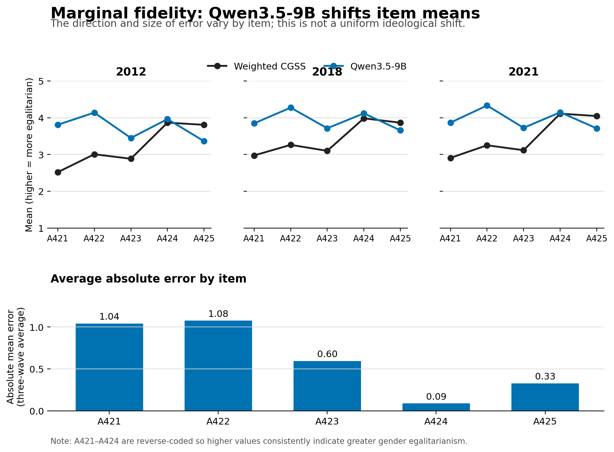
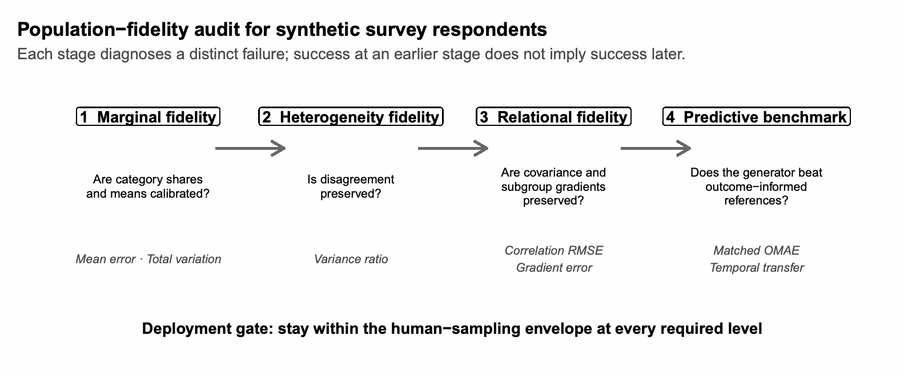
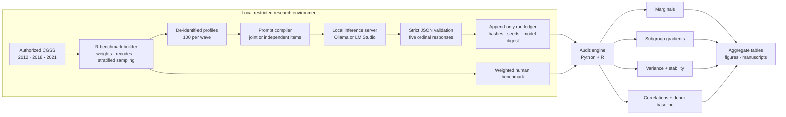
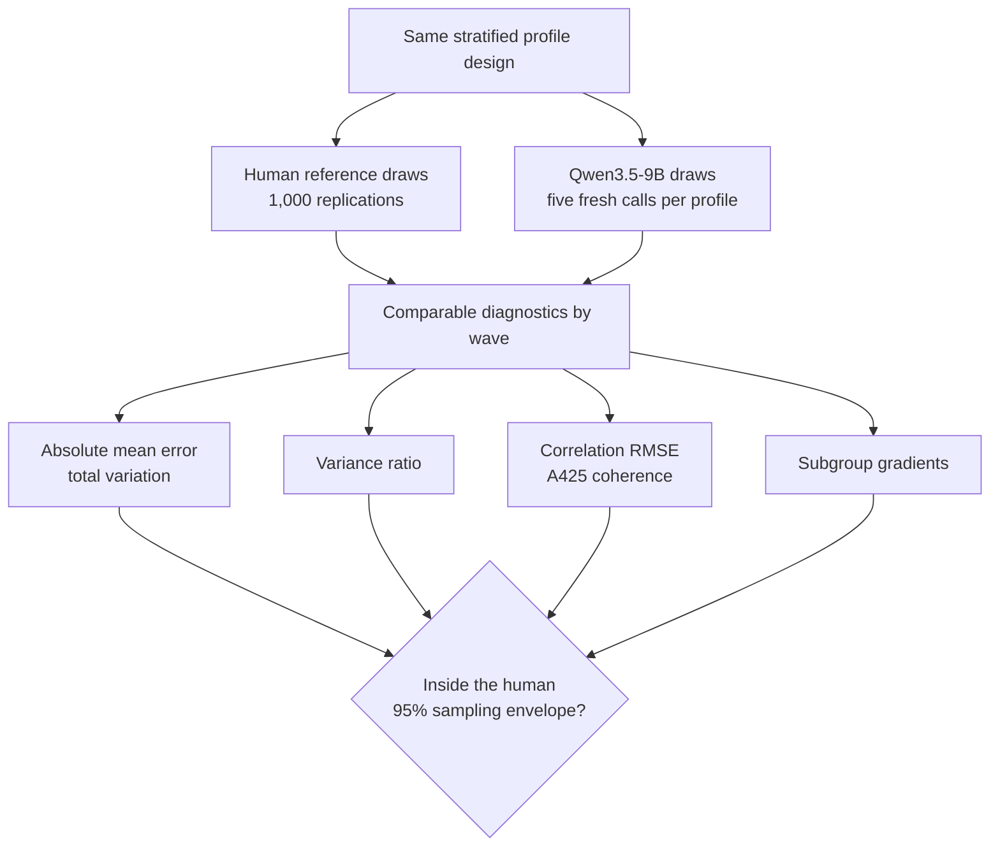
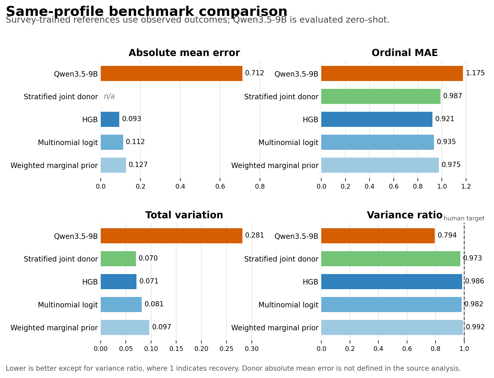
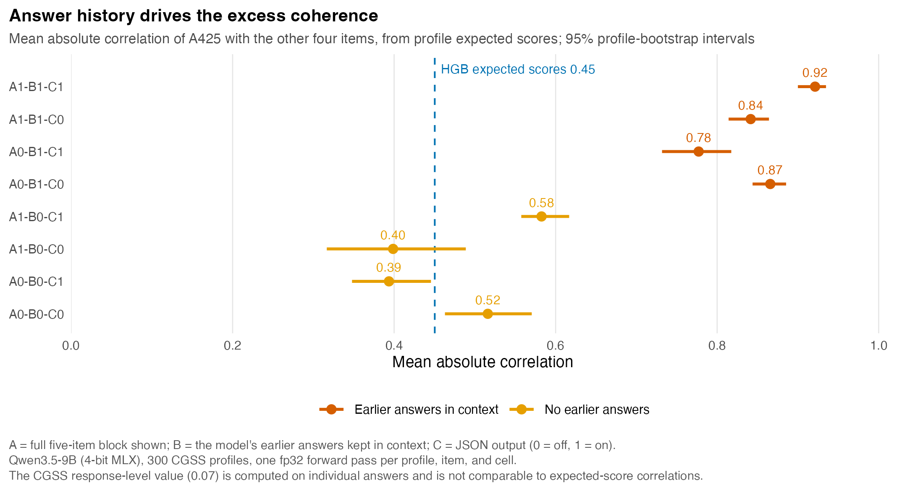
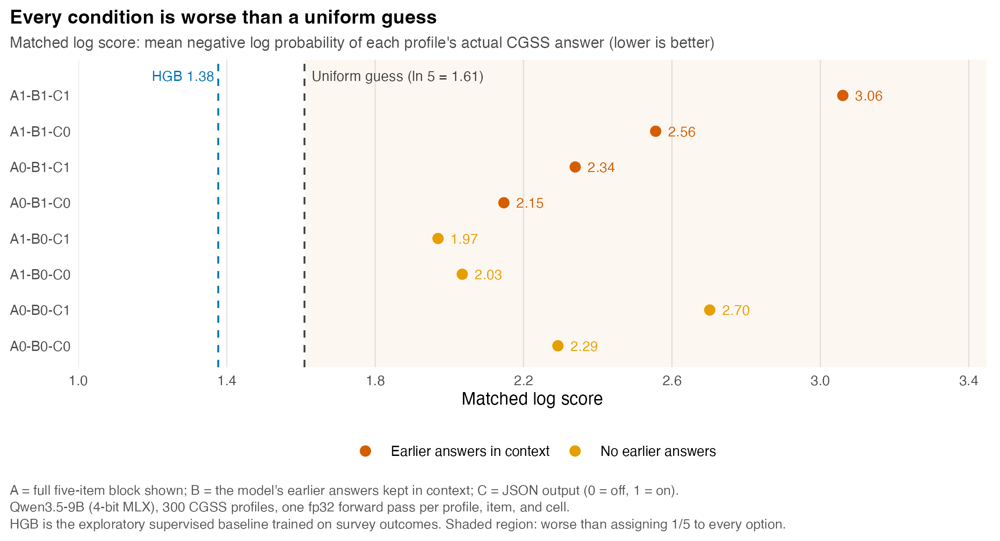
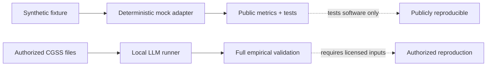

<div align="center">

# SurveyLLM-Eval

### Can an LLM reproduce a real survey population from demographics alone?

**A reproducible audit of Qwen3.5-9B against 31,856 CGSS respondents**

[](https://github.com/4b8wsfdk7y-cloud/cgss-gender-attitude-llm-audit/actions/workflows/ci.yml)
[](https://www.python.org/)
[](https://www.r-project.org/)
[](#system-architecture)
[](#data-and-reproducibility-boundary)
[](LICENSE)

[English](README.md) · [中文](README.zh-CN.md)

[Overview](#overview) · [20-second result](#the-result-in-20-seconds) · [What I built](#what-i-built) ·
[Architecture](#system-architecture) · [Results](#results-at-a-glance) · [Quick start](#public-quick-start) ·
[Full pilot](#run-the-authorized-pilot) · [Papers](#research-artifacts) ·
[v2 update](#v2-option-probability-audit-october-2026)

</div>

## Overview

SurveyLLM-Eval asks whether LLM-generated “synthetic respondents” can recover
a real population—not merely produce one answer that sounds human. I gave a
locally run Qwen3.5-9B model only the demographic attributes of 300
de-identified profiles sampled from CGSS 2012, 2018, and 2021. The model never
saw those respondents' actual attitudes. It answered the same five-item
gender-attitude battery in five fresh calls per profile.

I compared the generated population with weighted benchmarks from 31,856 human
respondents, repeated human samples of the same size, survey-trained machine-
learning models, and a joint-donor baseline. The audit tests not only means,
but also category distributions, stable differences between profiles, and
relationships among attitudes.

The result is mixed but ultimately negative: Qwen3.5-9B recovers one wave's
overall response variance, but 11 of 12 wave-level core diagnostics still fall
outside the human-sampling reference range. This repository contains the local
inference pipeline, audit package, public synthetic demo, tests, aggregate
findings, and accompanying paper.

> **October 2026 update.** A follow-up audit reads the model's full probability
> distribution over the five response options instead of sampling answers, and
> uses a preregistered 2×2×2 experiment to separate three presentation choices
> that the first audit confounded. It also found that the v1 answers were
> generated with the model's thinking mode left on. Under the v1 prompt,
> turning it off moves the A421 mean by about one scale point and roughly
> doubles the housework item's coherence with the other four. See
> [v2: option-probability audit](#v2-option-probability-audit-october-2026).

## The result in 20 seconds

The local Qwen3.5-9B model produces fluent, profile-conditioned answers, but it
does not recover the surveyed population. Across CGSS 2012, 2018, and 2021,
11 of 12 wave-level core diagnostics fall outside the corresponding 95% human-
sampling envelope; only the 2012 variance ratio falls inside.

| Mean error ↓ | Distribution error ↓ | Variance recovery → 1 | Correlation error ↓ |
|---:|---:|---:|---:|
| **0.569–0.707** | **0.214–0.268** | **0.668–0.975** | **0.143–0.192** |
| Human upper bound: 0.168 | Human upper bound: 0.104 | Human range: 0.846–1.141 | Human upper bound: 0.141 |



Qwen3.5-9B improves substantially on the earlier Qwen3-8B run, especially in
variance recovery. The remaining failure is still structural: item means and
category shares are distorted, stable between-profile differences are weak,
and the joint prompt makes attitudes more coherent than they are in CGSS.

## What I built

This project connects a substantive survey question to a reproducible software
and evaluation system:

| Layer | Implementation | What it demonstrates |
|---|---|---|
| Local inference | Ollama / LM Studio adapters, strict JSON schemas, recorded sampling requests | LLM systems engineering without sending restricted data to external APIs |
| Run reliability | Append-only JSONL ledger, prompt/config/model hashes, resumable calls | Defensive pipeline design and experiment provenance |
| Evaluation | Python package plus survey-weighted R analysis | Marginal, subgroup, variance, correlation, stability, and predictive diagnostics |
| Benchmarking | Human-sampling envelopes, joint-donor and supervised baselines | Separating sparse-profile limits from generator-specific failure |
| Public release | Synthetic fixture, CLI, tests, CI, documented data boundary | Reproducibility without redistributing licensed microdata |
| Probability audit (v2) | MLX forward passes, fp32 option probabilities, preregistered factorial design | Reading the model's distribution directly instead of inferring it from samples |



## Why this audit

LLM-generated “synthetic respondents” can sound plausible and still represent
the wrong population. A model may match an item mean while compressing
disagreement, distorting subgroup differences, or inventing correlations that
do not exist among human respondents.

This repository therefore treats the LLM as an **object of validation**, not a
replacement for respondents. It compares profile-conditioned model responses
with weighted human benchmarks from CGSS 2012, 2018, and 2021 at four levels:

| Evaluation target | Main diagnostic | Failure hidden by a mean-only comparison |
|---|---|---|
| Marginal fidelity | category distribution, mean error, total variation | Wrong response shape |
| Dispersion | variance ratio | Artificially homogeneous respondents |
| Heterogeneity | subgroup gradients, matched-profile error | Flattened or exaggerated social differences |
| Relational structure | correlation RMSE, joint-donor baseline | Invented coherence across attitudes |
| Stochastic behavior | repeated draws, within-profile stability | Confusing randomness with fidelity |

> **Core principle:** stability is not validity. A model can be consistently
> wrong, and repeated sampling cannot repair a misspecified response structure.

## System architecture

The research path keeps licensed microdata local. Only de-identified profile
descriptions enter a locally served model; the public repository contains no
respondent-level CGSS records or profile-linked model logs.



The model runner is deliberately defensive:

- prompt, configuration, and model digests prevent incompatible runs from
  being silently mixed;
- deterministic seeds and an append-only JSONL ledger make interrupted runs
  resumable;
- strict response schemas reject missing, extra, or out-of-range answers;
- local inference keeps licensed microdata and derived profiles off external
  APIs;
- the public mock adapter tests software behavior without masquerading as an
  empirical LLM result.

See [`docs/architecture.md`](docs/architecture.md) for the package-level design.

## Frozen experiment

| Component | Frozen core configuration |
|---|---|
| Survey benchmark | CGSS 2012, 2018, and 2021 |
| Attitude battery | five ordinal gender-attitude items, A421–A425 |
| Profile sample | 300 total: 100 stratified profiles per wave |
| Local model | `qwen/qwen3.5-9b` served through LM Studio |
| Primary prompt | `neutral_verbal` |
| Repeated generation | five fresh stochastic joint calls per profile |
| Output | integer JSON enforced by the request's response schema |
| Thinking mode | on (LM Studio default); answers were generated inside an open `<think>` block, see [v2](#why-v1-and-v2-differ-the-thinking-context) |
| Human reference | 1,000 replications of the same stratified sampling design |
| Reliability | all 1,500 primary joint calls succeeded |

The frozen results use `config_qwen35_lmstudio.json`. LM Studio did not confirm
that requested seeds were applied, so repeats are treated as fresh stochastic
calls rather than exactly reproducible seeded draws.

## Evaluation design

Each diagnostic is tied to a distinct estimand. The human sampling envelope
asks how much error the same 100-profile-per-wave design would produce if it
sampled humans rather than generated answers.



The envelope is a **reference distribution**, not a confidence interval for a
universal model effect. The matched-profile and donor analyses answer different
questions and are reported separately.

## Results at a glance

Across the three waves, 11 of 12 core Qwen3.5-9B diagnostics fall outside the
corresponding 95% human-sampling envelope. The exception is the 2012 variance
ratio; the 2018 and 2021 variance ratios remain below the human range.

| Diagnostic | Qwen estimate across waves | Human 95% reference | Reading |
|---|---:|---:|---|
| Absolute mean error ↓ | 0.569–0.707 | upper bound 0.160–0.168 | Large marginal error |
| Total variation ↓ | 0.214–0.268 | upper bound 0.100–0.104 | Wrong category distributions |
| Variance ratio → 1 | 0.668–0.975 | 0.846–1.141 | Improved, but inconsistent across waves |
| Correlation RMSE ↓ | 0.143–0.192 | upper bound 0.137–0.141 | Wrong joint structure |
| A425 mean absolute correlation ↓ | 0.232–0.335 | upper bound 0.198–0.234 | Excessive cross-item coherence |

Three findings matter most:

1. **The bias is item-specific, not a uniform ideological shift.** Qwen3.5-9B
   overstates egalitarianism on A421–A424 but understates support for equal
   housework on A425.
2. **Repeated draws restore randomness more than stable social differences.**
   The mean marginal variance ratio is `0.794`, but `68.2%` of predictive
   variance occurs within profiles across calls; the between-profile ratio is
   only `0.265`.
3. **Sparse profiles are not the whole explanation.** HGB reduces total
   variation from `0.282` to `0.071`, while a joint-donor baseline reduces
   correlation RMSE from `0.173` to `0.085`.



The independent-item ablation reduces A425 coherence by `0.130` on average
(profile-bootstrap 95% interval: `0.050–0.178`). The reduction is concentrated
in 2018, and independent presentation does not consistently recover the human
structure. It is evidence about a presentation bundle, not a clean causal
isolation of shared context.

## v2: option-probability audit (October 2026)

The first audit sampled five answers per profile through a local inference
server. That design left three questions open: whether the fixed seeds were
applied, what probability the model actually assigned to each option, and
whether the extra coherence of the joint prompt came from seeing the other
items, from the model's own earlier answers, or from the JSON output format.
v2 is built to answer them.

| | v1 (frozen, August 2026) | v2 (October 2026) |
|---|---|---|
| Model | Qwen3.5-9B served through LM Studio | Qwen3.5-9B, 4-bit MLX, local |
| Response | five sampled answers per profile and item (T = 0.7, top-p = 0.9) | one forward pass; probabilities of options 1–5 at T = 1, renormalized |
| Reproducibility | seed application could not be verified | full-prompt computation is bit-for-bit identical across runs |
| Design | joint prompt plus one independent-item run | preregistered 2×2×2 factorial: item block visible (A) × answer history (B) × JSON output (C) |
| Scale | 300 profiles | 300 profiles × 5 items × 8 cells = 12,000 forward passes |

**Engineering details that changed the numbers**

- The model's default bf16 logits are coarse (step 0.125), and option
  probabilities moved by up to 0.031 depending on how they were computed. The
  final-position projection now runs in fp32, where two computation paths
  differ by at most about 1e-5. The first 1,072 bf16 records were set aside and
  the run restarted; the preregistration's change log records this.
- Prefix (KV) caching changed the most probable option for 2 of 80 smoke-test
  prompts, so every formal prompt is computed in full.
- A JSON answer prefix without a trailing space let the model put up to 65% of
  next-token probability on a space token. The prompt was fixed before the
  formal run.
- The probability mass on the valid options "1"–"5" averages above 0.999 in
  every cell.

**Preregistration.** [`PREREGISTRATION_V2.md`](PREREGISTRATION_V2.md) was
committed on 13 October 2026 (`995b353`), before any CGSS profile was scored.
The primary estimand is the mean absolute correlation between item A425 and
the other four items, computed from profile-level expected scores, with 2,000
profile bootstrap replicates drawn within wave.

**Main results** ([`output/v2/`](output/v2/))

| Effect on A425 mean absolute correlation | Estimate | 95% CI |
|---|---:|---:|
| B: answer history in context | +0.379 | [0.339, 0.410] |
| A: full item block visible | +0.048 | [0.022, 0.074] |
| C: JSON output | +0.013 | [−0.013, 0.039] |
| A × C | +0.237 | [0.192, 0.286] |
| A × B × C | −0.138 | [−0.239, −0.044] |



- The inflated coherence comes mainly from the model seeing its own earlier
  answers. Cells without answer history range from 0.39 to 0.58 (an
  exploratory supervised HGB baseline gives 0.45); cells with history range
  from 0.78 to 0.92. The CGSS response-level value (0.07) is computed on
  individual answers, not expected scores, and is not directly comparable.
- Output format has no detectable main effect with modal histories; its
  effect depends on whether the item block is visible. With sampled histories
  the main effect is small and positive (robustness check below).
- In every cell the matched log score (1.97–3.06) is worse than a uniform guess
  over five options (ln 5 ≈ 1.61): the model is confidently wrong about
  individual respondents. The best ranked probability score is 0.191
  (A0-B0-C0), against 0.149 for HGB.



- Marginal accuracy depends on presentation. The mean absolute error of item
  means ranges from 0.30 (A0-B0-C0) to 1.06 (A1-B1-C0). The cell closest to the
  CGSS means has a between-profile variance ratio of 0.09: it gives nearly the
  same answer to everyone.

<a id="why-v1-and-v2-differ-the-thinking-context"></a>
**Why v1 and v2 differ: the thinking context**

v2 item means were far from v1's (A421 on the original 1–5 response scale:
4.42 in A1-B1-C1 against 2.16 in v1),
and a verbal-label cell did not explain the gap. A check of the v1 runner, the
v1 response files, and the LM Studio server logs from the v1 run found three
things the v1 description had wrong or left out:

- v1 used a system prompt ("你正在参加一项社会调查模拟。严格遵守用户要求，只返回JSON，不解释推理。").
- v1 never produced verbal labels. Each request carried an integer-only JSON
  schema, which overrode the prompt's request for a label; all 1,500 v1 answers
  are integer JSON.
- v1 ran with thinking enabled. LM Studio's model definition turns thinking on
  by default, and Qwen3.5's chat template has no `/no_think` switch. In every
  logged call, `content` is empty and the JSON sits in `reasoning_content`: the
  model wrote its answers inside an open `<think>` block. The model weights are
  the same as in v2.

A diagnostic scored A421 for the 300 v1 prompts with thinking open and closed,
changing nothing else:

| A421, v1 prompt | Thinking open (v1) | Thinking closed (v2) |
|---|---:|---:|
| Expected score after v1 decoding (T = 0.7, top-p = 0.9) | 2.13 | 3.26 |
| v1 sampled mean | 2.16 | 2.16 |
| Mean log-likelihood of the 1,500 v1 answers | −1.53 | −8.30 |
| v1 answers with zero probability | 15 | 395 |
| Correlation with v1 profile means | 0.54 | 0.27 |

The open thinking block accounts for the v1 answers far better. Two
exploratory cells, specified in the preregistration before they were run,
extend the comparison to all five items:

| v1 prompt, five items, most probable earlier answers | V1-T1: thinking open | V1-T0: thinking closed | A1-B1-C1 (v2 prompt) |
|---|---:|---:|---:|
| A425 mean absolute correlation [95% CI] | 0.44 [0.37, 0.50] | 0.91 [0.90, 0.92] | 0.92 [0.90, 0.93] |
| Mean absolute gap from v1 sampled item means (v1 decoding) | 0.23 | 0.62 | 1.47 |
| Mean absolute error of item means against CGSS (T = 1) | 0.68 | 0.36 | 0.95 |
| Between-profile variance ratio | 0.14 | 0.65 | 0.41 |
| Matched log score (uniform guess: 1.61) | 1.96 | 1.99 | 3.06 |

- With the v1 prompt and thinking closed, coherence equals that of A1-B1-C1
  (difference −0.01, 95% CI −0.03 to 0.01). Opening the thinking block lowers
  it by 0.47 (95% CI 0.41 to 0.54). On the primary estimand, the thinking
  context accounts for the difference between the v1 and v2 set-ups; the
  system prompt and wording do not.
- The prompt differences do move item means. With thinking closed, the v1
  prompt is closer to CGSS than A1-B1-C1 (mean absolute error 0.36 against
  0.95).
- Thinking open comes closest to v1's item means. A421 and A425 are within
  0.11 of v1; A422–A424 are 0.25–0.45 lower than v1. The cells condition on the
  most probable earlier answers, whereas v1 sampled them, so the two
  procedures are not the same.
- Every factorial result above was obtained with thinking closed. Thinking was
  not crossed with A, B, and C, so the size of the answer-history effect with
  thinking open is not known; V1-T1 keeps the history in context and reaches
  0.44, close to the HGB baseline's 0.45. These values come from expected
  scores and are not on the scale of v1's 0.23–0.34, which was computed on
  sampled answers.
- The two cells were added after the A421 diagnostic and are exploratory
  ([`output/v2/v1_context_*.csv`](output/v2/),
  [`scripts/11_run_v1_context_cells.py`](scripts/11_run_v1_context_cells.py),
  [`scripts/13_analyze_v1_context.py`](scripts/13_analyze_v1_context.py)).

**Measurement models (Part 3 of the preregistration)**

Ordinal one-factor models (WLSMV) for the five items, recoded so that higher
means more egalitarian ([`output/v2/part3_*.csv`](output/v2/)):

| Population | n | A425 standardized loading | Other loadings | Solution |
|---|---:|---:|---:|---|
| CGSS (weighted, complete cases) | 31,177 | 0.16 | 0.55–0.77 | proper |
| v1 sampled answers (5 replicates) | 300 each | 0.39–0.55 (median 0.48) | 0.66–0.92 | proper |
| v2 modal answers, A1-B1-C1 | 300 | 1.02 | 0.88–0.99 | improper |
| v2 modal answers, A0-B0-C0 | 300 | 0.57 | −0.28–1.09 | improper; A424 dropped |

- In every synthetic population, A425 loads on the common factor much more
  strongly than among people: the difference from CGSS is 0.23–0.39 in the v1
  replicates, with all 95% intervals above zero. The modal-answer populations
  are close to deterministic (polychoric correlations up to 0.998), so their
  factor solutions are improper and the CGSS-versus-A1-B1-C1 configural model
  is not estimable.
- CGSS versus each v1 replicate: equal thresholds and equal loadings are both
  rejected by the scaled difference test (p < .001), while scaled CFI changes
  by less than 0.01. The human sample is about a hundred times larger than the
  synthetic one, so the loading differences above are the more informative
  result.
- Graded-response discriminations tell the same story: A425's discrimination
  relative to the mean of the other four items is 0.17 in CGSS and 0.30–0.53
  in the v1 replicates.

**Preregistered robustness check: sampled answer histories (29 October 2026)**

The factorial cells with history condition on the most probable earlier
answers. The robustness check, specified in the preregistration's 2026-10-28
entry before the run, replaces them with five seeded draws per profile from the
model's own option distributions: 300 profiles × 4 history cells × 5 paths × 5
items = 30,000 scored prompts. Replaying the seeded draws reproduces every
recorded history ([`output/v2/robustness_*.csv`](output/v2/)).

| Cell | Modal history, expected scores | Sampled history, expected scores (R2) | Drawn answers, response level (R1) |
|---|---:|---:|---:|
| A0-B0-C0 | 0.52 | no history | 0.13 |
| A0-B0-C1 | 0.39 | no history | 0.16 |
| A1-B0-C0 | 0.40 | no history | 0.09 |
| A1-B0-C1 | 0.58 | no history | 0.21 |
| A0-B1-C0 | 0.87 | 0.75 | 0.37 |
| A0-B1-C1 | 0.78 | 0.75 | 0.44 |
| A1-B1-C0 | 0.84 | 0.76 | 0.36 |
| A1-B1-C1 | 0.92 | 0.87 | 0.57 |

| Effect | Modal history | Sampled history (R2) | Response level (R1) |
|---|---:|---:|---:|
| B: answer history | +0.379 [0.339, 0.410] | +0.309 [0.271, 0.338] | +0.288 |
| A: item block visible | +0.048 [0.022, 0.074] | +0.048 [0.021, 0.074] | +0.035 |
| C: JSON output | +0.013 [−0.013, 0.039] | +0.042 [0.015, 0.070] | +0.106 |
| A × C | +0.237 [0.192, 0.286] | +0.207 [0.163, 0.256] | +0.112 |
| A × B × C | −0.138 [−0.239, −0.044] | −0.197 [−0.290, −0.107] | +0.048 |

- Answer history remains the largest effect. Conditioning on the most probable
  answer overstates coherence by 0.06–0.12 in three history cells
  (A0-B1-C1: −0.03, interval −0.05 to 0.00), and the history effect falls from
  0.38 to 0.31.
- At the response level, the four cells without history give 0.09–0.21, within
  the range of human samples of 100 per wave (median 0.10, 97.5th percentile
  0.22); the full weighted CGSS value is 0.069. The four cells with history
  give 0.36–0.57, above that range and above v1 (0.27), whose answers were
  generated with the thinking block open. The survey-trained HGB comparator
  gives 0.08.
- The output-format result is not robust: with sampled histories JSON output
  has a small positive main effect (+0.04, interval 0.02 to 0.07). The
  three-way interaction changes sign at the response level.
- With sampled histories, item-mean errors against CGSS change little (mean
  absolute error 0.35–0.97 across the history cells, against 0.31–1.06), and
  the between-profile variance ratio falls in three of the four cells.
- Percentile intervals for response-level correlations lie above the point
  estimates when the correlations are small (A1-B0-C0: 0.090, interval 0.099
  to 0.141), because resampled duplicate profiles inflate absolute
  correlations near zero. Response-level effects are therefore reported
  without intervals here; the computed intervals are in
  `robustness_effects.csv`.

**Exploratory analyses (added 29 October 2026)**

Specified in the preregistration's 2026-10-29 entry before they were run; they
do not change any preregistered estimand.

*The direction of the item-mean errors depends on the configuration.* In
egalitarian coding ([`output/v2/v2_item_means_egalitarian.csv`](output/v2/v2_item_means_egalitarian.csv)),
error against the wave-averaged CGSS mean:

| | A421 | A422 | A423 | A424 | A425 |
|---|---:|---:|---:|---:|---:|
| CGSS mean | 2.80 | 3.17 | 3.03 | 3.99 | 3.91 |
| v1 sampled answers (thinking open) | +1.04 | +1.08 | +0.60 | +0.09 | −0.33 |
| V1-T1 (v1 prompt, thinking open) | +0.80 | +1.16 | +0.74 | +0.27 | −0.43 |
| A0-B0-C1 (target item only, JSON) | +0.37 | +1.10 | +0.90 | +0.77 | −1.46 |
| A1-B1-C1 (v2 reference) | −1.22 | −0.23 | −0.69 | −1.03 | −1.56 |
| A1-B0-C0 (item block, no history, integer) | −0.65 | −0.36 | −0.60 | −1.30 | +0.01 |

v1's pattern (more egalitarian than CGSS on A421–A424, less on A425) appears
when the thinking block is open and when only the target item is shown with
JSON output. In all four cells that show the item block, the model is less
egalitarian than CGSS on A421–A424. A425 is understated in six of the eight
factorial cells. The sign of the bias is a property of the configuration,
not of the model alone.

*Subgroup gradients* ([`output/v2/exploratory_subgroup_gradients.csv`](output/v2/exploratory_subgroup_gradients.csv)).
Within wave, egalitarian-coded expected scores are regressed on sex, years of
education, age, and urban residence (the v1 specification); the benchmark is
the weighted full-CGSS regression. Coefficients averaged over waves:

| Coefficient | CGSS, public roles (A421–A424) | CGSS, housework (A425) | Model, public roles (8 cells) | Model, housework (8 cells) | v1 sampled, public / housework |
|---|---:|---:|---:|---:|---:|
| Female | 0.15 | 0.30 | 0.11–0.58 | 0.17–0.69 | 0.22 / 0.50 |
| Years of education | 0.055 | 0.019 | 0.017–0.084 | 0.011–0.098 | 0.018 / 0.073 |
| Urban residence | 0.16 | 0.02 | 0.13–0.36 | 0.03–0.88 | 0.20 / 0.29 |

- Among CGSS respondents, urban residence and education go with more
  egalitarian answers on the public-role items but hardly with A425, and women
  differ from men more on A425 than on the public-role items.
- The model extends the social gradients to the housework item. In seven of
  the eight factorial cells the urban-residence coefficient for A425 is
  0.21–0.88, against 0.02 in CGSS, with every interval for the difference above
  zero; v1's sampled answers give 0.29. For education, the public-minus-housework
  difference is +0.036 in CGSS and between −0.070 and +0.015 in every cell, all
  intervals for the difference below zero.
- The gender gap on the public-role items is larger than in CGSS in seven of
  the eight cells. Whether the model keeps the larger gender gap on housework
  differs by cell.
- This is the subgroup counterpart of the A425 result: the model tends to give
  the whole battery one set of social gradients. Many
  coefficients are compared here, so only patterns that hold across cells are
  described.

*Survey-trained comparator at the response level.* Five draws per profile
from the out-of-fold HGB distributions give a response-level A425 coherence of
0.08, the median for human samples of 100 per wave being 0.10. A generator
whose distributions barely differ between profiles produces low response-level
correlations whatever its structure, so values near the human range in the
cells without history are not evidence of a correct structure.

<!-- HUMANHIST -->

**What v2 does not show**

- v2 is not a replication or validation of v1. Beyond the thinking context,
  the designs differ in the system prompt, in the user prompt, in decoding (v1
  sampled at T = 0.7 and top-p = 0.9; v2 reads T = 1 probabilities), and in
  answer history.
- The exploratory analyses were specified after the preregistered results were
  known and should be read as such.
- The results describe one 4-bit local model and do not generalize to other
  models or quantizations.

**Code.** [`scripts/07_run_logprob_audit.py`](scripts/07_run_logprob_audit.py)
runs the forward passes and writes an append-only ledger;
[`scripts/08_export_human_benchmark.R`](scripts/08_export_human_benchmark.R)
exports the weighted human benchmark;
[`scripts/09_analyze_logprob_audit.py`](scripts/09_analyze_logprob_audit.py)
computes the estimands and bootstrap intervals;
[`scripts/10_plot_v2.R`](scripts/10_plot_v2.R) draws the two figures above from
the aggregate tables in `output/v2/`;
[`scripts/11_run_v1_context_cells.py`](scripts/11_run_v1_context_cells.py) and
[`scripts/13_analyze_v1_context.py`](scripts/13_analyze_v1_context.py) run and
analyze the two v1-prompt cells;
[`scripts/12_measurement_models.R`](scripts/12_measurement_models.R) fits the
Part 3 measurement models. Probability extraction and the
factorial prompts live in
[`src/survey_llm_eval/probabilities.py`](src/survey_llm_eval/probabilities.py)
and [`src/survey_llm_eval/factorial.py`](src/survey_llm_eval/factorial.py), with
tests in `tests/test_probabilities.py` and `tests/test_factorial.py`. Running
them requires the licensed CGSS-derived files.

## Public quick start

The public demo requires no CGSS data, model download, or API key. It uses a
clearly labeled synthetic fixture and deterministic mock adapter to exercise
the package, schemas, marginal and relational metrics, report generation, and
CLI.

```bash
git clone https://github.com/4b8wsfdk7y-cloud/cgss-gender-attitude-llm-audit.git
cd cgss-gender-attitude-llm-audit
python3 -m venv .venv
source .venv/bin/activate
python -m pip install --editable .
survey-llm-eval demo --output-dir output/public_demo
python -m unittest discover -s tests -v
```

Expected CLI summary:

```json
{
  "benchmark": "CGSS gender-attitude audit",
  "demo_only": true,
  "human_records": 12,
  "model_records": 36,
  "correlation_rmse": 0.81965,
  "output_dir": "output/public_demo"
}
```

The demo writes `output/public_demo/demo_report.json` and
`mock_responses.csv`. These are software fixtures—not CGSS findings or model
benchmark results.

To evaluate another benchmark with the same schema, provide one human-reference
CSV and one model-response CSV. The command validates both inputs and writes
aggregate diagnostics without copying source records into the report:

```bash
survey-llm-eval evaluate \
  --spec benchmarks/cgss_gender_attitudes.json \
  --human fixtures/demo_human_synthetic.csv \
  --model output/public_demo/mock_responses.csv \
  --output output/public_demo/evaluation_report.json
```

The report covers category distributions, mean and variance errors, subgroup
diagnostics, pairwise-correlation RMSE, and within-profile repeat stability.



## Run the authorized pilot

### 1. Build the restricted benchmark

Set the directory containing authorized `CGSS2012.dta`, `CGSS2018.dta`, and
`CGSS2021.dta` files:

```bash
export CGSS_RAW_DIR="/absolute/path/to/authorized/cgss/files"
Rscript scripts/00_build_authorized_benchmark.R
```

The generated `data/source/dimension_pilot_results.rds` remains restricted.
Inspect `PUBLIC_RELEASE_MANIFEST.md` before sharing the project.

### 2. Inspect the prepared model inputs

```bash
Rscript scripts/01_prepare_profiles.R
```

The script prints the first ten de-identified profiles before writing the full
pilot input. Inspect those rows before starting inference.

### 3. Run local inference

Start LM Studio, load `qwen/qwen3.5-9b`, and run the primary condition:

```bash
python3 scripts/02_run_local_llm.py \
  --config config_qwen35_lmstudio.json \
  --output-dir output_qwen35 \
  --conditions neutral_verbal \
  --repeats 5
```

The runner appends one record per completed call and skips matching
`profile_id × condition × repeat` keys on restart. Use a separate output
directory for every model configuration:

```bash
python3 scripts/02_run_local_llm.py \
  --config config_ollama_qwen3_8b.json \
  --output-dir output_qwen3_8b_legacy \
  --conditions neutral_verbal \
  --repeats 5
```

### 4. Evaluate and regenerate figures

```bash
Rscript scripts/03_evaluate_audit.R
Rscript scripts/05_extended_validation.R
Rscript paper/reproduce.R
```

## Follow-up experiments

The joint runner presents all five items in one prompt. The independent-item
runner presents exactly one item per fresh call, repeats the full persona, and
uses no conversation history:

```bash
python3 scripts/04_run_independent_items.py
```

The prespecified exploratory contrast is:

```text
delta_r = mean_abs_correlation_joint - mean_abs_correlation_independent
```

A profile-bootstrap interval entirely above zero would support
context-induced coherence. The realized design contains one independent answer
but five joint repeats per profile-item, so it does not isolate prompt context
from decoding variability or model representation. The v2 factorial design
separates these factors; see
[v2: option-probability audit](#v2-option-probability-audit-october-2026).

The extended validation also includes:

- survey-weighted Pearson correlations, with unweighted Pearson and polychoric
  sensitivity estimates;
- a stratified joint-donor benchmark matching wave, sex, education group, and
  urban residence;
- matched human and supervised-ML reference models;
- profile-level bootstrap resampling that keeps all five items and repeats
  together.

## Repository map

```text
survey-llm-eval/
├── src/survey_llm_eval/   reusable schemas, metrics, run guards, and CLI
├── benchmarks/            declarative benchmark specification
├── fixtures/              synthetic public-demo records
├── tests/                 dependency-free unit tests
├── scripts/               CGSS preparation, local inference, and R evaluation
├── prompts/               versioned prompt conditions
├── ml/                    supervised human-response benchmarks
├── output/                aggregate metrics and public figures
├── paper/                 manuscripts, supplement, and reproduction script
├── presentation/          PPE forum presentation
└── docs/                  architecture and reproducibility notes
```

## Tested environment

- R 4.5.2; package versions are recorded in
  `environment/R-session-info.txt`
- Python 3.10 or later; the LLM runners use the standard library only
- supervised ML dependencies are pinned in `ml/requirements.txt`
- frozen results: `qwen/qwen3.5-9b` through LM Studio, configured in
  `config_qwen35_lmstudio.json`
- legacy comparison setup: `qwen3:8b` through Ollama, configured in
  `config_ollama_qwen3_8b.json`
- v2 probability audit: MLX 0.32.3 and mlx-lm 0.31.3 on an Apple M4 with 24 GB,
  weights `lmstudio-community/Qwen3.5-9B-MLX-4bit`; Part 3 models with lavaan
  0.7-3, semTools 0.5.10, and mirt 1.48; the exploratory HGB with history
  with scikit-learn 1.7.2 and scipy 1.14.1 (see `ml/README.md`)

## Main outputs

| Path | Contents | Public? |
|---|---|---|
| `output/metrics_*.csv` | aggregate validation diagnostics | Yes |
| `output/figures/` | aggregate comparison figures | Yes |
| `paper/` | current manuscripts, bibliography, final PDFs | Yes |
| `data/profiles_pilot.csv` | sampled profiles with held-out responses | No |
| `data/profiles_llm_input.csv` | model-facing derived profiles | No |
| `output/responses*.jsonl` | immutable profile-linked model logs | No |

## Research artifacts

- [`paper/main_showcase.pdf`](paper/main_showcase.pdf) — current English
  Qwen3.5-9B showcase manuscript
- [`paper/chinese-audit-paper.pdf`](paper/chinese-audit-paper.pdf) — Chinese
  Qwen3.5-9B research paper
- [`presentation/ppe-forum-presentation.pdf`](presentation/ppe-forum-presentation.pdf)
  — Qwen3.5-9B PPE forum presentation

Earlier manuscript versions based on the legacy Qwen3-8B run are kept outside
this public repository. The Qwen3.5-9B showcase manuscript is the current
reference version. The Chinese paper and the forum presentation predate the
October 2026 correction of the v1 call description (thinking mode on, integer
output only); the English manuscript states the correction.

## Data and reproducibility boundary

The public repository fully reproduces the synthetic demo, Python package,
tests, benchmark schema, and metric calculations. Reproducing the empirical
CGSS comparison requires licensed CGSS microdata and the restricted derived
files rebuilt from them.

The repository does **not** redistribute respondent records, derived profiles,
or profile-linked model outputs. A passing CI workflow verifies software
behavior; it does not validate synthetic respondents or recreate the paper's
numerical findings. See
[`docs/reproducibility-boundary.md`](docs/reproducibility-boundary.md).

## Interpretation boundary

These findings apply to one frozen local model and experimental design. They do
not establish that all LLMs fail, that model architecture alone caused the
errors, or that a joint-donor baseline is an optimal predictor. Profile-level
errors are descriptive and are not estimates of individual latent attitudes.

The evidence supports auditing model-generated survey responses along several
estimands. It does **not** support replacing human respondents.

## Citation

When reusing the audit design or code, cite this repository and the
accompanying paper. Cite CGSS, model providers, and third-party packages
separately under their own terms. Machine-readable metadata is available in
[`CITATION.cff`](CITATION.cff).

## License

Code is released under the [MIT License](LICENSE). Data and third-party
materials remain subject to their original terms.
