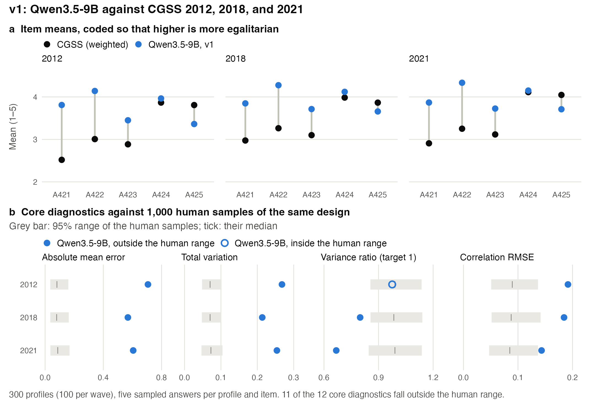
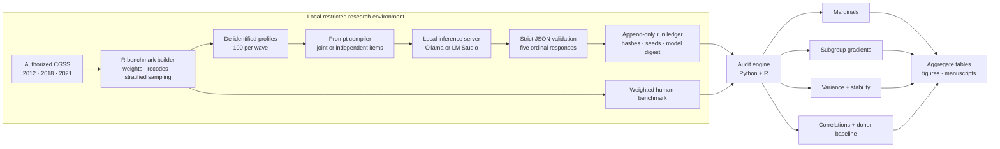
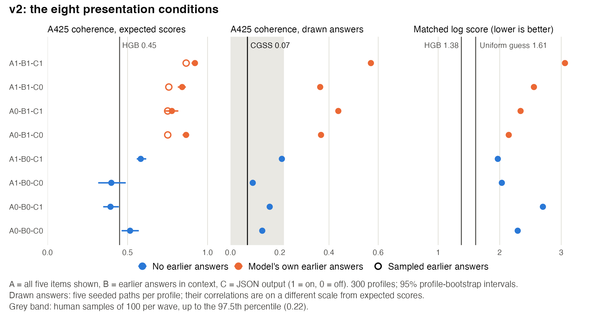
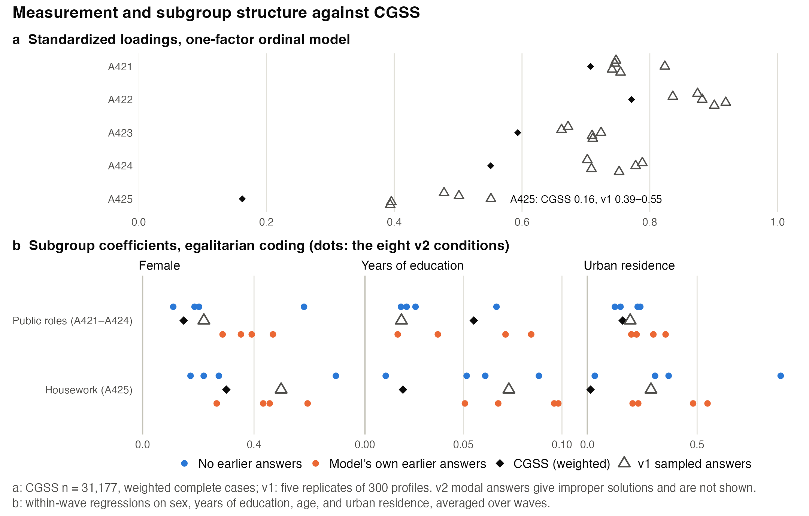
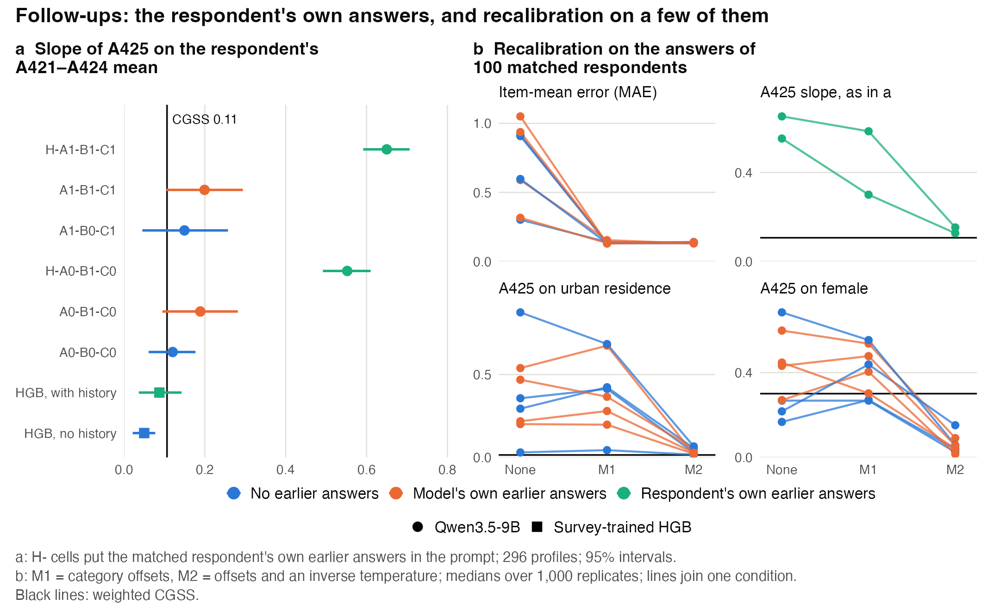

<div align="center">

# SurveyLLM-Eval

### Can an LLM reproduce a real survey population from demographics alone?

**A reproducible audit of Qwen3.5-9B against 31,856 CGSS respondents**

[](https://github.com/4b8wsfdk7y-cloud/cgss-gender-attitude-llm-audit/actions/workflows/ci.yml)
[](https://www.python.org/)
[](https://www.r-project.org/)
[](#system-architecture)
[](#data-and-reproducibility-boundary)
[](LICENSE)

[English](README.md) · [中文](README.zh-CN.md)

[Overview](#overview) · [Results](#results) · [What I built](#what-i-built) ·
[Architecture](#system-architecture) · [v2 update](#v2-option-probability-audit-october-2026) ·
[Quick start](#public-quick-start) · [Full pilot](#run-the-authorized-pilot) · [Papers](#research-artifacts)

</div>

## Overview

SurveyLLM-Eval asks whether LLM-generated “synthetic respondents” can recover
a real population, not merely produce answers that sound human. I gave a
locally run Qwen3.5-9B model only the demographic attributes of 300
de-identified profiles sampled from CGSS 2012, 2018, and 2021; it never saw
those respondents' attitudes and answered the five-item gender-attitude
battery in five fresh calls per profile. The generated population is compared
with weighted benchmarks from 31,856 respondents, repeated human samples of
the same size, survey-trained machine-learning models, and a joint-donor
baseline, on means, category distributions, between-profile differences, and
relationships among attitudes.

The result is mixed but ultimately negative: Qwen3.5-9B recovers one wave's
response variance, but 11 of 12 wave-level core diagnostics fall outside the
human-sampling reference range.

> **October 2026 update.** A follow-up audit reads the model's probabilities
> over the five response options and uses a preregistered 2×2×2 experiment to
> separate three presentation choices that the first audit confounded. The v1
> answers turned out to have been generated with the model's thinking mode on;
> under the v1 prompt, turning it off moves the A421 mean by about one scale
> point and roughly doubles the housework item's coherence with the other four.
> With thinking off, the model's own earlier answers are the main source of
> that coherence (+0.38 on the preregistered estimand, +0.31 when the earlier
> answers are sampled), and the direction of the item-mean errors changes with
> the configuration. See [v2](#v2-option-probability-audit-october-2026).

## Results

Across the three waves, 11 of 12 core diagnostics fall outside the
corresponding 95% human-sampling envelope; only the 2012 variance ratio falls
inside.

| Diagnostic | Qwen3.5-9B across waves | Human 95% reference | Reading |
|---|---:|---:|---|
| Absolute mean error ↓ | 0.569–0.707 | upper bound 0.160–0.168 | Large marginal error |
| Total variation ↓ | 0.214–0.268 | upper bound 0.100–0.104 | Wrong category distributions |
| Variance ratio → 1 | 0.668–0.975 | 0.846–1.141 | Improved, but inconsistent across waves |
| Correlation RMSE ↓ | 0.143–0.192 | upper bound 0.137–0.141 | Wrong joint structure |
| A425 mean absolute correlation ↓ | 0.232–0.335 | upper bound 0.198–0.234 | Excessive cross-item coherence |



1. **The bias is item-specific, not a uniform ideological shift.** In this
   configuration the model overstates egalitarianism on A421–A424 and
   understates support for equal housework on A425; v2 shows that the
   direction depends on the configuration.
2. **Repeated draws restore randomness more than stable social differences.**
   The mean marginal variance ratio is `0.794`, but `68.2%` of predictive
   variance occurs within profiles across calls; the between-profile ratio is
   only `0.265`.
3. **Sparse profiles are not the whole explanation.** HGB reduces total
   variation from `0.282` to `0.071`, while a joint-donor baseline reduces
   correlation RMSE from `0.173` to `0.085`.

Presenting each item in its own call reduces A425 coherence by `0.130`
(profile-bootstrap 95% interval `0.050–0.178`), mostly in 2018. That ablation
changes a bundle of presentation choices at once; v2 separates them.

## What I built

| Layer | Implementation | What it demonstrates |
|---|---|---|
| Local inference | Ollama / LM Studio adapters, strict JSON schemas, recorded sampling requests | LLM systems engineering without sending restricted data to external APIs |
| Run reliability | Append-only JSONL ledger, prompt/config/model hashes, resumable calls | Defensive pipeline design and experiment provenance |
| Evaluation | Python package plus survey-weighted R analysis | Marginal, subgroup, variance, correlation, stability, and predictive diagnostics |
| Benchmarking | Human-sampling envelopes, joint-donor and supervised baselines | Separating sparse-profile limits from generator-specific failure |
| Public release | Synthetic fixture, CLI, tests, CI, documented data boundary | Reproducibility without redistributing licensed microdata |
| Probability audit (v2) | MLX forward passes, fp32 option probabilities, preregistered factorial design | Reading the model's distribution directly instead of inferring it from samples |

## Why this audit

A model can match an item mean while compressing disagreement, distorting
subgroup differences, or inventing correlations that do not exist among human
respondents. The audit therefore treats the LLM as an **object of
validation**, not a replacement for respondents.

| Evaluation target | Main diagnostic | Failure hidden by a mean-only comparison |
|---|---|---|
| Marginal fidelity | category distribution, mean error, total variation | Wrong response shape |
| Dispersion | variance ratio | Artificially homogeneous respondents |
| Heterogeneity | subgroup gradients, matched-profile error | Flattened or exaggerated social differences |
| Relational structure | correlation RMSE, joint-donor baseline | Invented coherence across attitudes |
| Stochastic behavior | repeated draws, within-profile stability | Confusing randomness with fidelity |

> **Core principle:** stability is not validity. A model can be consistently
> wrong, and repeated sampling cannot repair a misspecified response structure.

## System architecture

Licensed microdata stay local. Only de-identified profile descriptions enter a
locally served model; the public repository contains no respondent-level CGSS
records or profile-linked model logs.



Prompt, configuration, and model digests keep incompatible runs from being
mixed; deterministic seeds and the ledger make interrupted runs resumable;
strict schemas reject missing, extra, or out-of-range answers; the public mock
adapter tests software behavior without posing as an empirical result. See
[`docs/architecture.md`](docs/architecture.md).

## Frozen experiment

| Component | Frozen core configuration |
|---|---|
| Survey benchmark | CGSS 2012, 2018, and 2021 |
| Attitude battery | five ordinal gender-attitude items, A421–A425 |
| Profile sample | 300 total: 100 stratified profiles per wave |
| Local model | `qwen/qwen3.5-9b` served through LM Studio |
| Primary prompt | `neutral_verbal` |
| Repeated generation | five fresh stochastic joint calls per profile |
| Output | integer JSON enforced by the request's response schema |
| Thinking mode | on (LM Studio default); answers were generated inside an open `<think>` block, see [v2](#why-v1-and-v2-differ-the-thinking-context) |
| Human reference | 1,000 replications of the same stratified sampling design |
| Reliability | all 1,500 primary joint calls succeeded |

The frozen results use `config_qwen35_lmstudio.json`. LM Studio did not confirm
that requested seeds were applied, so repeats are treated as fresh stochastic
calls. The human envelope asks how much error the same design would produce if
it sampled people instead of generating answers; it is a reference
distribution, not a confidence interval for a model effect.

## v2: option-probability audit (October 2026)

The first audit left three questions open: whether the fixed seeds were
applied, what probability the model assigned to each option, and whether the
extra coherence of the joint prompt came from seeing the other items, from the
model's own earlier answers, or from the JSON output format.

| | v1 (frozen, August 2026) | v2 (October 2026) |
|---|---|---|
| Model | Qwen3.5-9B served through LM Studio | Qwen3.5-9B, 4-bit MLX, local |
| Response | five sampled answers per profile and item (T = 0.7, top-p = 0.9) | one forward pass; probabilities of options 1–5 at T = 1, renormalized |
| Reproducibility | seed application could not be verified | full-prompt computation is bit-for-bit identical across runs |
| Design | joint prompt plus one independent-item run | preregistered 2×2×2 factorial: item block visible (A) × answer history (B) × JSON output (C) |
| Scale | 300 profiles | 300 profiles × 5 items × 8 cells = 12,000 forward passes |

[`PREREGISTRATION_V2.md`](PREREGISTRATION_V2.md) was committed on 13 October
2026 (`995b353`), before any CGSS profile was scored. The primary estimand is
the mean absolute correlation between A425 and the other four items, computed
from profile-level expected scores, with 2,000 profile bootstrap replicates
drawn within wave. Three engineering fixes came first: the final-position
projection runs in fp32, because bf16 logits moved option probabilities by up
to 0.031 (the 1,072 bf16 records were set aside); every prompt is computed in
full, because prefix caching changed the most probable option for 2 of 80
test prompts; and the JSON answer prefix ends in a space, without which up to
65% of next-token probability went to a space token. The mass on the options
“1”–“5” averages above 0.999 in every cell.

**Main results** ([`output/v2/`](output/v2/)). The preregistered robustness
check (28 October entry) replaces the most probable earlier answers with five
seeded draws per profile from the model's own distributions, 30,000 scored
prompts; drawn answers are the response-level values from those paths.

| Effect on A425 mean absolute correlation | Most probable history | Sampled history | Drawn answers |
|---|---:|---:|---:|
| B: answer history in context | +0.379 [0.339, 0.410] | +0.309 [0.271, 0.338] | +0.288 |
| A: full item block visible | +0.048 [0.022, 0.074] | +0.048 [0.021, 0.074] | +0.035 |
| C: JSON output | +0.013 [−0.013, 0.039] | +0.042 [0.015, 0.070] | +0.106 |
| A × C | +0.237 [0.192, 0.286] | +0.207 [0.163, 0.256] | +0.112 |
| A × B × C | −0.138 [−0.239, −0.044] | −0.197 [−0.290, −0.107] | +0.048 |



- The inflated coherence comes mainly from the model seeing its own earlier
  answers: 0.39–0.58 in the cells without history (the survey-trained HGB
  baseline gives 0.45), 0.78–0.92 with the most probable history, and
  0.75–0.87 with a sampled one.
- For drawn answers, the cells without history give 0.09–0.21, within the
  range of human samples of 100 per wave (median 0.10, 97.5th percentile 0.22;
  full weighted CGSS 0.069), and the cells with history 0.36–0.57. A generator
  whose distributions barely differ between profiles gives low response-level
  correlations whatever its structure (HGB: 0.08), so the first range is not
  evidence of a correct structure. Response-level effects are reported without
  intervals because resampled duplicate profiles push the percentile intervals
  of small correlations above the point estimates; the intervals are in
  `robustness_effects.csv`.
- The output-format result is not robust: JSON output has no detectable main
  effect with the most probable history and a small positive one with sampled
  histories, and the three-way interaction changes sign for drawn answers.
- Every cell's matched log score (1.97–3.06) is worse than a uniform guess over
  five options (ln 5 ≈ 1.61): the model is confidently wrong about individual
  respondents. The best ranked probability score is 0.191 (A0-B0-C0), against
  0.149 for HGB.
- The mean absolute error of item means ranges from 0.30 (A0-B0-C0) to 1.06
  (A1-B1-C0). The cell closest to the CGSS means has a between-profile variance
  ratio of 0.09: it gives nearly the same answer to everyone.

<a id="why-v1-and-v2-differ-the-thinking-context"></a>
**Why v1 and v2 differ: the thinking context**

v2 item means were far from v1's (A421 on the original scale: 4.42 in A1-B1-C1
against 2.16 in v1). The v1 runner, response files, and LM Studio server logs
show that v1 used a system prompt
(“你正在参加一项社会调查模拟。严格遵守用户要求，只返回JSON，不解释推理。”),
that an integer-only response schema overrode the prompt's request for verbal
labels, and that thinking was on: in every logged call `content` is empty and
the JSON sits in `reasoning_content`, so the model wrote its answers inside an
open `<think>` block. The weights are the same as in v2. Scoring A421 for the
300 v1 prompts with the thinking block open and closed, the mean
log-likelihood of the 1,500 v1 answers is −1.53 and −8.30. Two exploratory
cells, preregistered before they were run, extend the comparison to all five
items ([`output/v2/v1_context_*.csv`](output/v2/)):

| v1 prompt, five items, most probable earlier answers | V1-T1: thinking open | V1-T0: thinking closed | A1-B1-C1 (v2 prompt) |
|---|---:|---:|---:|
| A425 mean absolute correlation [95% CI] | 0.44 [0.37, 0.50] | 0.91 [0.90, 0.92] | 0.92 [0.90, 0.93] |
| Mean absolute gap from v1 sampled item means (v1 decoding) | 0.23 | 0.62 | 1.47 |
| Mean absolute error of item means against CGSS (T = 1) | 0.68 | 0.36 | 0.95 |
| Between-profile variance ratio | 0.14 | 0.65 | 0.41 |
| Matched log score (uniform guess: 1.61) | 1.96 | 1.99 | 3.06 |

- With thinking closed, the v1 prompt gives the same coherence as A1-B1-C1
  (difference −0.01, 95% CI −0.03 to 0.01); opening the thinking block lowers
  it by 0.47 (0.41 to 0.54). On the primary estimand the thinking context
  accounts for the v1–v2 difference; the system prompt and wording move the
  item means but not the coherence.
- Every factorial result was obtained with thinking closed, and thinking was
  not crossed with A, B, and C. The values above come from expected scores and
  are not on the scale of v1's 0.23–0.34, which was computed on sampled
  answers.

**Measurement and subgroup structure**



- *Measurement models* (Part 3 of the preregistration,
  [`output/v2/part3_*.csv`](output/v2/)). In ordinal one-factor models (WLSMV),
  A425 loads 0.16 in CGSS (n = 31,177; other items 0.55–0.77) and 0.39–0.55 in
  the five v1 replicates (other items 0.66–0.92); the differences from CGSS,
  0.23–0.39, all have 95% intervals above zero. Graded-response models agree:
  A425's discrimination relative to the other four items is 0.17 in CGSS and
  0.30–0.53 in v1. The v2 modal-answer populations are close to deterministic
  (polychoric correlations up to 0.998) and give improper solutions.
- *Subgroup gradients* (exploratory,
  [`exploratory_subgroup_gradients.csv`](output/v2/exploratory_subgroup_gradients.csv)).
  Among CGSS respondents, urban residence and education go with more
  egalitarian answers on the public-role items but hardly with A425. The model
  extends these gradients to housework: in seven of the eight cells the
  urban-residence coefficient for A425 is 0.21–0.88, against 0.01 in CGSS (v1:
  0.29), every interval for the difference above zero; for education, the
  public-minus-housework difference is +0.036 in CGSS and between −0.070 and
  +0.015 in every cell, every interval for the difference below zero.
- *Direction of the item-mean errors* (exploratory,
  [`v2_item_means_egalitarian.csv`](output/v2/v2_item_means_egalitarian.csv)).
  v1's pattern, more egalitarian than CGSS on A421–A424 and less on A425,
  appears when the thinking block is open and when only the target item is
  shown with JSON output. In all four cells that show the item block the model
  is less egalitarian than CGSS on A421–A424, and A425 is understated in six of
  the eight cells.

**Follow-up analyses (exploratory, 29 October 2026)**

Each was specified in the preregistration before it was run; none changes a
preregistered estimand.



*The respondent's own answers*
([`exploratory_history_dependence.csv`](output/v2/exploratory_history_dependence.csv),
[`exploratory_human_history_calibration.csv`](output/v2/exploratory_human_history_calibration.csv)).
H-A1-B1-C1 and H-A0-B1-C0 use the A1-B1-C1 and A0-B1-C0 prompts, but the
history holds the matched CGSS respondent's own earlier answers (296
profiles). Given a person's real answers, the model moves its A425 prediction
with their mean at slopes of 0.65 [0.59, 0.71] and 0.55 [0.49, 0.61], five to
six times the CGSS slope (0.11) and 0.56 and 0.46 above HGB with the same
history (intervals 0.49 to 0.62 and 0.39 to 0.53). The excess coherence is
therefore not only the model building on its own earlier errors. These answers
make A425's log score much worse in H-A1-B1-C1 (+1.76 against no history,
interval 1.42 to 2.13); in H-A0-B1-C0 they improve it (−0.29, interval −0.49 to
−0.10) but worsen the ranked probability score (+0.058, interval 0.041 to
0.075). Every model cell scores A425 worse than a uniform guess, while HGB with
the same history improves on every item and on both scores.

*Recalibrating on a small human sample*
([`exploratory_calibration_*.csv`](output/v2/)). For each cell and item, the
option distributions are recalibrated on the answers of n matched respondents
(50, 100, 200, or all 296) by penalised maximum likelihood, with category
offsets (M1) or offsets and an inverse temperature (M2). Each of 1,000
replicates resamples profiles within wave and draws a new calibration sample;
values are medians over replicates. For the eight factorial cells the table
gives the range of cell medians and, in parentheses, the number of cells whose
interval for the difference from CGSS excludes zero.

| | Uncalibrated | M1, n = 100 | M2, n = 100 | CGSS |
|---|---:|---:|---:|---:|
| Mean absolute error of item means | 0.30–1.05 | 0.13–0.15 | 0.13–0.14 | |
| Between-profile variance ratio | 0.04–0.41 | 0.09–0.37 | 0.01–0.04 | |
| A425 slope on the respondent's A421–A424 mean, H-A1-B1-C1 | 0.65 [0.59, 0.71] | 0.59 [0.42, 0.76] | 0.15 [0.01, 0.30] | 0.11 |
| A425 slope on the respondent's A421–A424 mean, H-A0-B1-C0 | 0.55 [0.49, 0.61] | 0.30 [0.17, 0.45] | 0.13 [0.04, 0.23] | 0.11 |
| A425 on urban residence | 0.03–0.88 (7/8) | 0.04–0.68 (7/8) | 0.02–0.07 (0/8) | 0.01 |
| A425 on female | 0.17–0.68 (6/8) | 0.27–0.55 (5/8) | 0.02–0.15 (7/8) | 0.30 |
| Public-role index on years of education | 0.018–0.085 (8/8) | 0.021–0.074 (3/8) | 0.009–0.024 (8/8) | 0.055 |

- Offsets bring the item means close to CGSS with 100 respondents but move
  every profile in the same direction, so the structural errors stay: the
  urban gradient on A425 is still off in seven of eight cells, and the A425
  slopes of 0.59 and 0.30 are 5.5 and 2.8 times the CGSS slope.
- Adding a temperature brings the slopes to 0.15 and 0.13 and the urban
  gradient back to the CGSS level by flattening the profiles (between-profile
  variance ratio 0.01–0.04), and real gradients go with it: the gender gap on
  A425 falls from 0.30 to 0.02–0.15, and the education gradient on the
  public-role items from 0.055 to 0.009–0.024. The fitted inverse temperatures
  are 0.01–0.53 at n = 100 and below 0.31 for A425 in every cell; they were not
  constrained to be positive, and at n = 296 one fit (A424 in A1-B0-C0) is
  slightly below zero.
- The calibration samples come from the respondents whose profiles were
  scored, the most favourable case for a researcher. Uncalibrated values here
  are bootstrap medians over 296 profiles and can differ in the second decimal
  from the values above.

*Questionnaire-exposure probe*
([`exploratory_exposure_order_test.csv`](output/v2/exploratory_exposure_order_test.csv),
[`exploratory_exposure_recall.csv`](output/v2/exploratory_exposure_recall.csv)).
The five items, one per line, are scored in all 120 orders under a CGSS header
and a neutral header (raw text, one forward pass per order). The CGSS order
ranks 85th under the CGSS header (permutation p = 0.71) and 23rd under the
neutral header (p = 0.19), while a positive control, the first five core
socialist values, ranks first (p = 0.008). Given the first k items in CGSS
order, the model reproduced none of the five items; one offensive completion
is masked in the public table, with its SHA-256 kept. There is no evidence
that the model has seen texts listing the battery in CGSS order. Whether
published CGSS response distributions entered its training data cannot be
tested this way.

**What v2 does not show**

- v2 is not a replication or validation of v1. Beyond the thinking context,
  the designs differ in the system prompt, in the user prompt, in decoding (v1
  sampled at T = 0.7 and top-p = 0.9; v2 reads T = 1 probabilities), and in
  answer history.
- The exploratory analyses were specified after the preregistered results were
  known and should be read as such.
- The results describe one 4-bit local model and do not generalize to other
  models or quantizations.

**Code**

| Step | Scripts |
|---|---|
| Forward passes, append-only ledger | [`07_run_logprob_audit.py`](scripts/07_run_logprob_audit.py) (`--history sampled` for the robustness check) |
| Weighted human benchmark | [`08_export_human_benchmark.R`](scripts/08_export_human_benchmark.R) |
| Estimands and bootstrap intervals | [`09_analyze_logprob_audit.py`](scripts/09_analyze_logprob_audit.py), [`14_analyze_sampled_history.py`](scripts/14_analyze_sampled_history.py) |
| v1-prompt cells | [`11_run_v1_context_cells.py`](scripts/11_run_v1_context_cells.py), [`13_analyze_v1_context.py`](scripts/13_analyze_v1_context.py) |
| Measurement models | [`12_measurement_models.R`](scripts/12_measurement_models.R) |
| Exploratory analyses | scripts 15–19, [`22_calibrate_with_human_sample.py`](scripts/22_calibrate_with_human_sample.py), [`23_probe_questionnaire_exposure.py`](scripts/23_probe_questionnaire_exposure.py) |
| Figures | [`24_plot_readme_figures.R`](scripts/24_plot_readme_figures.R) for this README; scripts 10, 20, and 21 for the results page in `docs/` |

Probability extraction and the factorial prompts live in
[`src/survey_llm_eval/probabilities.py`](src/survey_llm_eval/probabilities.py)
and [`src/survey_llm_eval/factorial.py`](src/survey_llm_eval/factorial.py),
with tests in `tests/test_probabilities.py` and `tests/test_factorial.py`. The
figure scripts read only the aggregate tables in `output/`, and script 23 needs
only the local model; the other scripts need the licensed CGSS-derived files.

## Public quick start

The public demo requires no CGSS data, model download, or API key. A clearly
labeled synthetic fixture and a deterministic mock adapter exercise the
package, schemas, marginal and relational metrics, report generation, and CLI;
its outputs are software fixtures, not CGSS findings or model results.

```bash
git clone https://github.com/4b8wsfdk7y-cloud/cgss-gender-attitude-llm-audit.git
cd cgss-gender-attitude-llm-audit
python3 -m venv .venv
source .venv/bin/activate
python -m pip install --editable .
survey-llm-eval demo --output-dir output/public_demo
python -m unittest discover -s tests -v
```

To evaluate another benchmark with the same schema, provide one human-reference
CSV and one model-response CSV; the report covers category distributions, mean
and variance errors, subgroup diagnostics, pairwise-correlation RMSE, and
within-profile repeat stability, without copying source records:

```bash
survey-llm-eval evaluate \
  --spec benchmarks/cgss_gender_attitudes.json \
  --human fixtures/demo_human_synthetic.csv \
  --model output/public_demo/mock_responses.csv \
  --output output/public_demo/evaluation_report.json
```

## Run the authorized pilot

```bash
# 1. Build the restricted benchmark from authorized CGSS2012/2018/2021 .dta files
export CGSS_RAW_DIR="/absolute/path/to/authorized/cgss/files"
Rscript scripts/00_build_authorized_benchmark.R

# 2. Prepare the model inputs; inspect the ten profiles printed first
Rscript scripts/01_prepare_profiles.R

# 3. Run local inference with qwen/qwen3.5-9b loaded in LM Studio
python3 scripts/02_run_local_llm.py \
  --config config_qwen35_lmstudio.json \
  --output-dir output_qwen35 \
  --conditions neutral_verbal \
  --repeats 5

# 4. Evaluate and regenerate figures
Rscript scripts/03_evaluate_audit.R
Rscript scripts/05_extended_validation.R
Rscript paper/reproduce.R

# Follow-up: one item per fresh call, full persona, no conversation history
python3 scripts/04_run_independent_items.py
```

The generated `data/source/dimension_pilot_results.rds` remains restricted;
inspect `PUBLIC_RELEASE_MANIFEST.md` before sharing the project. The runner
appends one record per completed call and skips matching
`profile_id × condition × repeat` keys on restart; use a separate output
directory for every model configuration (the legacy Qwen3-8B run uses
`config_ollama_qwen3_8b.json`). The extended validation adds survey-weighted
Pearson correlations with unweighted and polychoric sensitivity estimates, a
stratified joint-donor benchmark, matched human and supervised-ML references,
and profile-level bootstrap resampling that keeps all five items and repeats
together.

## Repository map

```text
survey-llm-eval/
├── src/survey_llm_eval/   reusable schemas, metrics, run guards, and CLI
├── benchmarks/            declarative benchmark specification
├── fixtures/              synthetic public-demo records
├── tests/                 dependency-free unit tests
├── scripts/               CGSS preparation, local inference, and R evaluation
├── prompts/               versioned prompt conditions
├── ml/                    supervised human-response benchmarks
├── output/                aggregate metrics and public figures
├── paper/                 manuscripts, supplement, and reproduction script
├── presentation/          PPE forum presentation
└── docs/                  architecture, reproducibility notes, results page
```

## Tested environment

- R 4.5.2; package versions are recorded in `environment/R-session-info.txt`
- Python 3.10 or later; the LLM runners use the standard library only;
  supervised ML dependencies are pinned in `ml/requirements.txt`
- frozen results: `qwen/qwen3.5-9b` through LM Studio
  (`config_qwen35_lmstudio.json`); legacy comparison: `qwen3:8b` through Ollama
  (`config_ollama_qwen3_8b.json`)
- v2 probability audit: MLX 0.32.3 and mlx-lm 0.31.3 on an Apple M4 with 24 GB,
  weights `lmstudio-community/Qwen3.5-9B-MLX-4bit`; Part 3 models with lavaan
  0.7-3, semTools 0.5.10, and mirt 1.48; the exploratory HGB with history with
  scikit-learn 1.7.2 and scipy 1.14.1 (see `ml/README.md`)

## Main outputs

| Path | Contents | Public? |
|---|---|---|
| `output/metrics_*.csv`, `output/v2/` | aggregate validation diagnostics | Yes |
| `output/figures/` | aggregate comparison figures | Yes |
| `paper/` | current manuscripts, bibliography, final PDFs | Yes |
| `data/profiles_pilot.csv` | sampled profiles with held-out responses | No |
| `data/profiles_llm_input.csv` | model-facing derived profiles | No |
| `output/responses*.jsonl` | immutable profile-linked model logs | No |

## Research artifacts

- [`paper/main_showcase.pdf`](paper/main_showcase.pdf) — current English
  Qwen3.5-9B showcase manuscript
- [`paper/chinese-audit-paper.pdf`](paper/chinese-audit-paper.pdf) — Chinese
  Qwen3.5-9B research paper
- [`presentation/ppe-forum-presentation.pdf`](presentation/ppe-forum-presentation.pdf)
  — Qwen3.5-9B PPE forum presentation

Earlier manuscript versions based on the legacy Qwen3-8B run are kept outside
this public repository. The Chinese paper and the forum presentation predate
the October 2026 correction of the v1 call description (thinking mode on,
integer output only); the English manuscript states the correction.

## Data and reproducibility boundary

The public repository fully reproduces the synthetic demo, Python package,
tests, benchmark schema, and metric calculations. Reproducing the empirical
CGSS comparison requires licensed CGSS microdata and the restricted derived
files rebuilt from them. The repository does **not** redistribute respondent
records, derived profiles, or profile-linked model outputs, and a passing CI
workflow verifies software behavior only. See
[`docs/reproducibility-boundary.md`](docs/reproducibility-boundary.md).

These findings apply to one local model and experimental design. They do not
establish that all LLMs fail, that model architecture alone caused the errors,
or that a joint-donor baseline is an optimal predictor. Profile-level errors
are descriptive and are not estimates of individual latent attitudes. The
evidence supports auditing model-generated survey responses along several
estimands; it does **not** support replacing human respondents.

## Citation

When reusing the audit design or code, cite this repository and the
accompanying paper. Cite CGSS, model providers, and third-party packages
separately under their own terms. Machine-readable metadata is available in
[`CITATION.cff`](CITATION.cff).

## License

Code is released under the [MIT License](LICENSE). Data and third-party
materials remain subject to their original terms.
