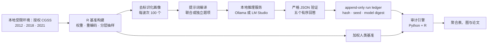

<div align="center">

# SurveyLLM-Eval

### 仅凭人口学特征，LLM 能否复现真实问卷人群？

**对 Qwen3.5-9B 与 31,856 名 CGSS 受访者的可复现审计**

[](https://github.com/4b8wsfdk7y-cloud/cgss-gender-attitude-llm-audit/actions/workflows/ci.yml)
[](https://www.python.org/)
[](https://www.r-project.org/)
[](README.md#system-architecture)
[](README.md#data-and-reproducibility-boundary)
[](LICENSE)

[English](README.md) · [中文](README.zh-CN.md)

[核心结果](#核心结果) · [我做了什么](#我做了什么) · [系统架构](#系统架构) ·
[第二版](#第二版选项概率审计2026-年-10-月) · [公开演示](#公开演示) · [数据边界](#数据与复现边界)

</div>

## 项目概览

这个项目检验 LLM 生成的“合成受访者”能否在总体层面复现真实的受访者群体。回答听起来像人说的，并不等于复现了人群。我向本地运行的 Qwen3.5-9B 提供 300 个去标识化人口学画像，分别来自 CGSS 2012、2018 和 2021 的分层样本；模型从未看到这些人的真实态度，每个画像在五个性别态度题项上接受五次独立生成。生成的人群与 31,856 名真实受访者的加权基准、同规模重复人类抽样、问卷训练的机器学习模型和 joint-donor 基线比较，比较内容包括均值、类别分布、画像间差异和态度之间的关系。

结论是混合但总体否定的：Qwen3.5-9B 在一个波次上复现了总体方差，但 12 个波次级核心诊断中仍有 11 个落在同等人类抽样的 95% 参考范围之外。

> **2026 年 10 月更新。** 第二版直接读取模型对五个选项的概率，用预注册的 2×2×2 析因实验拆开第一版混在一起的三个呈现因素。核查中还发现，第一版的回答是在模型思考模式开启时生成的；用第一版提示词关掉思考后，A421 均值移动约 1 分，家务题与其余四题的一致性大约翻倍。思考关闭时，一致性主要来自模型自己之前的回答（预注册指标 +0.38，前题回答改为抽样时 +0.31）；题目均值偏差的方向随配置改变。详见[第二版](#第二版选项概率审计2026-年-10-月)。

## 核心结果

在 CGSS 三个波次中，12 个核心诊断有 11 个超出对应的人类抽样 95% 参考范围；只有 2012 年的方差比落入范围内。

| 诊断 | Qwen 三个波次的估计 | 人类 95% 参考范围 | 解读 |
|---|---:|---:|---|
| 绝对均值误差 ↓ | 0.569–0.707 | 上界 0.160–0.168 | 边际均值误差大 |
| Total variation ↓ | 0.214–0.268 | 上界 0.100–0.104 | 类别分布错误 |
| 方差比 → 1 | 0.668–0.975 | 0.846–1.141 | 有改进但跨波次不稳定 |
| Correlation RMSE ↓ | 0.143–0.192 | 上界 0.137–0.141 | 联合结构错误 |
| A425 平均绝对相关 ↓ | 0.232–0.335 | 上界 0.198–0.234 | 跨题项一致性过强 |


1. **偏误因题项而异，没有整体朝一个意识形态方向移动。** 在这一配置下，模型在 A421–A424 上高估平等程度，在 A425 上低估对平分家务的支持；第二版发现偏差方向随配置改变。
2. **重复调用恢复的主要是随机性，画像间的稳定差异较少。** 边际方差比的均值为 `0.794`，但 `68.2%` 的预测方差出现在同一画像的不同调用之间，画像间方差比只有 `0.265`。
3. **稀疏画像不是唯一原因。** HGB 把 total variation 从 `0.282` 降到 `0.071`，joint-donor 基线把 correlation RMSE 从 `0.173` 降到 `0.085`。

每道题单独调用时，A425 一致性平均下降 `0.130`（画像 bootstrap 95% 区间 `0.050–0.178`），下降主要出现在 2018 年。这项消融同时改变了好几个呈现因素，第二版把它们拆开。

## 我做了什么

| 层次 | 实现 | 说明 |
|---|---|---|
| 本地推理 | Ollama / LM Studio adapter、严格 JSON schema、保存采样请求 | 不把受限数据发送到外部 API |
| 运行可靠性 | append-only JSONL ledger、prompt/config/model hash、断点续跑 | 保留实验来源与运行轨迹 |
| 评估 | Python 包与 survey-weighted R 分析 | 检验边际、子群体、方差、相关、稳定性和预测表现 |
| 基准 | 人类抽样包络、joint-donor、监督学习基线 | 区分稀疏画像的限制与生成器本身的失败 |
| 公开发布 | 合成 fixture、CLI、tests、CI、清晰的数据边界 | 在不重发许可微观数据的前提下保持可复现 |
| 概率审计（第二版） | MLX 前向计算、fp32 选项概率、预注册析因设计 | 直接读取模型的分布，不再从抽样结果推断 |

## 为什么这样审计

模型可能碰巧匹配一项平均数，却压缩分歧、扭曲群体差异，或生成真实人群中并不存在的态度相关性。因此，本项目把 LLM 当作需要验证的对象，不把它当作受访者的替代品。

| 被检验的对象 | 主诊断 | 仅看均值会漏掉什么 |
|---|---|---|
| 边际保真度 | 类别分布、均值误差、total variation | 回答形状错误 |
| 离散程度 | 方差比 | 人群被人为同质化 |
| 异质性 | 子群体梯度、matched-profile error | 社会差异被压平或夸大 |
| 关系结构 | correlation RMSE、joint-donor 基线 | 被虚构的态度一致性 |
| 随机行为 | 重复抽样、同画像稳定性 | 把随机性误认为保真度 |

> **核心原则：稳定不等于有效。** 模型可以稳定地错；多次采样不能修复错误的回答结构。

## 系统架构

受许可保护的微观数据始终留在本地环境。只有去标识化画像进入本地模型服务；公开仓库不包含受访者级 CGSS 数据或可回连画像的模型日志。



冻结实验使用 `qwen/qwen3.5-9b`、`neutral_verbal` 主提示、300 个画像和每个画像五次新的随机联合调用；全部 1,500 次主调用成功，回答在思考模式开启时生成（见[第二版](#v1-v2-thinking)）。LM Studio 未确认请求的 seed 是否实际生效，因此重复结果被视为新的随机调用。人类抽样包络回答的是：同样的设计如果抽的是真人，会产生多大误差；它是参考分布，不是模型效应的置信区间。完整模块设计见 [`docs/architecture.md`](docs/architecture.md)。

## 第二版：选项概率审计（2026 年 10 月）

第一版留下了三个问题：固定随机种子是否生效；模型对每个选项实际给出多大概率；联合提问时多出来的一致性，来自看到其他题目、看到自己之前的回答，还是来自 JSON 输出格式。

| | 第一版（已冻结，2026 年 8 月） | 第二版（2026 年 10 月） |
|---|---|---|
| 模型 | Qwen3.5-9B，通过 LM Studio 调用 | Qwen3.5-9B，4-bit MLX，本地运行 |
| 回答 | 每个画像、每道题抽样五次（T = 0.7，top-p = 0.9） | 一次前向计算，读取 T = 1 时选项 1–5 的概率并重新归一化 |
| 可复现性 | 无法确认种子是否生效 | 完整计算两次运行逐位一致 |
| 设计 | 联合提示，外加一次单题独立运行 | 预注册的 2×2×2 析因实验：题组可见（A）× 作答历史（B）× JSON 输出（C） |
| 规模 | 300 个画像 | 300 个画像 × 5 道题 × 8 个条件 = 12,000 次前向计算 |

[`PREREGISTRATION_V2.md`](PREREGISTRATION_V2.md) 于 2026 年 10 月 13 日提交（`995b353`），早于给任何 CGSS 画像打分。主要估计量是 A425 与其余四题的平均绝对相关，用画像层面的期望分数计算，在波次内做 2,000 次画像 bootstrap。正式运行前修正了三处工程问题：末位投影改用 fp32，因为 bf16 logits 会让选项概率随计算方式变化，最大差 0.031（最早的 1,072 条 bf16 记录已另存）；正式提示一律完整计算，因为前缀缓存让 80 个测试提示中有 2 个的最高选项发生变化；JSON 回答前缀末尾加上空格，否则模型会把最多 65% 的下一个 token 概率放在空格上。每个条件中，有效选项“1”–“5”上的概率之和平均都在 0.999 以上。

**主要结果**（[`output/v2/`](output/v2/)）。预注册的稳健性检验（10 月 28 日条目）把最可能的前题回答换成从模型自己的选项分布中按固定种子抽取的回答，每个画像 5 条路径，共 30,000 次打分；“抽出的回答”是这些路径在回答层面的值。

| 对 A425 平均绝对相关的效应 | 最可能历史 | 抽样历史 | 抽出的回答 |
|---|---:|---:|---:|
| B：保留作答历史 | +0.379 [0.339, 0.410] | +0.309 [0.271, 0.338] | +0.288 |
| A：显示整个题组 | +0.048 [0.022, 0.074] | +0.048 [0.021, 0.074] | +0.035 |
| C：JSON 输出 | +0.013 [−0.013, 0.039] | +0.042 [0.015, 0.070] | +0.106 |
| A × C | +0.237 [0.192, 0.286] | +0.207 [0.163, 0.256] | +0.112 |
| A × B × C | −0.138 [−0.239, −0.044] | −0.197 [−0.290, −0.107] | +0.048 |


- 一致性偏高主要来自模型看到自己之前的回答：无作答历史的条件为 0.39–0.58（问卷训练的 HGB 基线为 0.45），有最可能历史的条件为 0.78–0.92，历史改为抽样时为 0.75–0.87。
- 抽出的回答中，4 个无历史条件为 0.09–0.21，落在真人每期 100 人抽样的范围内（中位数 0.10，97.5 分位数 0.22；CGSS 加权全样本为 0.069），4 个有历史的条件为 0.36–0.57。画像之间分布差异很小的生成器，无论结构如何，回答层面的相关都会很低（HGB 为 0.08），所以前一个范围不能说明结构是对的。回答层面的效应只报告点估计，因为重抽样中重复出现的画像会让较小相关的百分位区间整体高于点估计；计算出的区间保留在 `robustness_effects.csv` 中。
- 输出格式的结论不稳健：用最可能历史时 JSON 输出没有可检测的主效应，用抽样历史时有一个小的正向主效应，三因素交互在回答层面改变了符号。
- 每个条件的匹配 log score（1.97–3.06）都比对五个选项的均匀猜测（ln 5 ≈ 1.61）差，说明模型对个体受访者是“有把握地错”。最好的 RPS 是 0.191（A0-B0-C0），HGB 为 0.149。
- 题目均值的平均绝对误差从 0.30（A0-B0-C0）到 1.06（A1-B1-C0）。最接近 CGSS 均值的条件，画像间方差比只有 0.09，几乎给每个人相同的回答。

<a id="v1-v2-thinking"></a>
**第一版和第二版为什么不同：思考模式**

第二版的题目均值与第一版相差很大（A421 按原始 1–5 计分，A1-B1-C1 为 4.42，第一版为 2.16）。核对第一版的运行脚本、回答文件和 LM Studio 服务器日志后发现：第一版用了系统提示词（“你正在参加一项社会调查模拟。严格遵守用户要求，只返回JSON，不解释推理。”）；每个请求都带有只允许整数的 JSON schema，覆盖了提示词里对文字标签的要求；第一版开着思考模式，日志里每次调用的 `content` 都是空的，JSON 在 `reasoning_content` 中，说明模型是在未关闭的 `<think>` 块里写出回答的。模型权重与第二版相同。只改变思考块的开关、为 300 个第一版提示的 A421 打分时，1,500 个第一版回答的平均对数似然在思考开启时为 −1.53，关闭时为 −8.30。两个探索性条件在运行前已写入预注册，把比较扩展到全部五道题（[`output/v2/v1_context_*.csv`](output/v2/)）：

| 第一版提示词，五道题，前题取最可能回答 | V1-T1：思考开启 | V1-T0：思考关闭 | A1-B1-C1（第二版提示词） |
|---|---:|---:|---:|
| A425 平均绝对相关 [95% CI] | 0.44 [0.37, 0.50] | 0.91 [0.90, 0.92] | 0.92 [0.90, 0.93] |
| 与第一版抽样题目均值的平均绝对差（第一版解码设置） | 0.23 | 0.62 | 1.47 |
| 题目均值相对 CGSS 的平均绝对误差（T = 1） | 0.68 | 0.36 | 0.95 |
| 画像间方差比 | 0.14 | 0.65 | 0.41 |
| 匹配 log score（均匀猜测为 1.61） | 1.96 | 1.99 | 3.06 |

- 用第一版提示词并关闭思考时，一致性与 A1-B1-C1 相同（差 −0.01，95% CI −0.03 到 0.01）；打开思考块使一致性下降 0.47（0.41 到 0.54）。就主要估计量而言，第一版和第二版设置之间的差别由思考模式解释；系统提示词和措辞会移动题目均值，但不影响一致性。
- 析因结果都在思考关闭时得到，思考模式没有与 A、B、C 交叉。上表的值来自期望分数，与第一版用抽样回答算出的 0.23–0.34 不在同一尺度上。

**测量结构与子群体结构**


- *测量模型*（预注册第 3 部分，[`output/v2/part3_*.csv`](output/v2/)）。有序单因子模型（WLSMV）中，A425 的载荷在 CGSS 中为 0.16（n = 31,177；其余四题 0.55–0.77），在第一版的 5 组回答中为 0.39–0.55（其余四题 0.66–0.92）；与 CGSS 之差为 0.23–0.39，95% 区间都在 0 以上。等级反应模型给出同样的结果：A425 的区分度与其余四题之比，CGSS 为 0.17，第一版为 0.30–0.53。第二版最可能回答构成的样本接近确定（多分格相关最高 0.998），因子解不合理（improper）。
- *子群体差异*（探索性，[`exploratory_subgroup_gradients.csv`](output/v2/exploratory_subgroup_gradients.csv)）。CGSS 受访者中，城镇居住和受教育程度与公共角色题上更平等的回答相关，与 A425 几乎无关。模型把这些梯度扩展到家务题：8 个析因条件中有 7 个，城镇居住对 A425 的系数为 0.21–0.88，CGSS 为 0.01（第一版为 0.29），差值的区间都在 0 以上；受教育年限“公共角色减家务”的差，CGSS 为 +0.036，各条件在 −0.070 到 +0.015 之间，差值的区间都在 0 以下。
- *题目均值误差的方向*（探索性，[`v2_item_means_egalitarian.csv`](output/v2/v2_item_means_egalitarian.csv)）。第一版的模式（A421–A424 比 CGSS 更平等，A425 更不平等）出现在思考块开启时，也出现在只显示当前题并用 JSON 输出时。显示整个题组的 4 个条件，在 A421–A424 上都比 CGSS 更不平等；A425 在 8 个析因条件中有 6 个被低估。

**追加分析（探索性，2026 年 10 月 29 日）**

每项分析都在运行前写入预注册，不改变任何预注册估计量。


*受访者自己的回答*（[`exploratory_history_dependence.csv`](output/v2/exploratory_history_dependence.csv)、[`exploratory_human_history_calibration.csv`](output/v2/exploratory_human_history_calibration.csv)）。H-A1-B1-C1 和 H-A0-B1-C0 的提示词分别同 A1-B1-C1 和 A0-B1-C0，但历史换成匹配的 CGSS 受访者自己对前几题的回答（296 个画像）。看到一个人的真实回答后，模型的 A425 预测随这些回答均值变化的斜率为 0.65 [0.59, 0.71] 和 0.55 [0.49, 0.61]，是 CGSS（0.11）的五到六倍，比带同样历史的 HGB 分别高 0.56（区间 0.49 到 0.62）和 0.46（区间 0.39 到 0.53）。所以过度一致不只是模型在自己之前的错误上继续延伸。这些回答让 H-A1-B1-C1 的 A425 log score 明显变差（与无历史相比 +1.76，区间 1.42 到 2.13）；在 H-A0-B1-C0 中让 log score 变好（−0.29，区间 −0.49 到 −0.10），但 RPS 变差（+0.058，区间 0.041 到 0.075）。所有模型条件在 A425 上的 log score 都比均匀猜测差，带同样历史的 HGB 则在每道题、两种评分上都变好。

*用少量真人样本重新校准*（[`exploratory_calibration_*.csv`](output/v2/)）。对每个条件的每道题，用 n 个匹配受访者（50、100、200 人或全部 296 人）的回答，以惩罚最大似然重新校准选项分布，分两种做法：只加类别偏移（M1），以及同时加类别偏移和逆温度（M2）。1,000 次重复中，每次在期内重抽画像，再重新抽取校准样本；数值是各次重复的中位数。8 个析因条件给出各条件中位数的范围，括号里是与 CGSS 之差的区间不含 0 的条件数。

| | 不校准 | M1，n = 100 | M2，n = 100 | CGSS |
|---|---:|---:|---:|---:|
| 题目均值的平均绝对误差 | 0.30–1.05 | 0.13–0.15 | 0.13–0.14 | |
| 画像间方差比 | 0.04–0.41 | 0.09–0.37 | 0.01–0.04 | |
| A425 对受访者 A421–A424 均值的斜率，H-A1-B1-C1 | 0.65 [0.59, 0.71] | 0.59 [0.42, 0.76] | 0.15 [0.01, 0.30] | 0.11 |
| A425 对受访者 A421–A424 均值的斜率，H-A0-B1-C0 | 0.55 [0.49, 0.61] | 0.30 [0.17, 0.45] | 0.13 [0.04, 0.23] | 0.11 |
| A425 对城镇居住的系数 | 0.03–0.88（7/8） | 0.04–0.68（7/8） | 0.02–0.07（0/8） | 0.01 |
| A425 对女性的系数 | 0.17–0.68（6/8） | 0.27–0.55（5/8） | 0.02–0.15（7/8） | 0.30 |
| 公共角色指数对受教育年限的系数 | 0.018–0.085（8/8） | 0.021–0.074（3/8） | 0.009–0.024（8/8） | 0.055 |

- 只加偏移时，100 个真人回答就能让题目均值接近 CGSS，但偏移让所有画像朝同一方向移动，结构上的误差留了下来：A425 的城乡梯度在 8 个条件中仍有 7 个偏离 CGSS，两个真人历史条件的斜率为 0.59 和 0.30，分别是 CGSS 的 5.5 倍和 2.8 倍。
- 加上逆温度后，斜率降到 0.15 和 0.13，A425 的城乡梯度回到 CGSS 的水平，这是靠压平画像之间的差别做到的（画像间方差比 0.01–0.04），真实存在的梯度也随之消失：A425 上的性别差距由 CGSS 的 0.30 降到 0.02–0.15，公共角色题的教育梯度由 0.055 降到 0.009–0.024。n = 100 时拟合出的逆温度为 0.01–0.53，A425 在每个条件中都低于 0.31；逆温度没有限定为正数，n = 296 时有一次拟合（A1-B0-C0 的 A424）略小于 0。
- 校准样本来自被打分画像对应的受访者，对研究者来说是最有利的情形。这里的不校准数值是 296 个画像上的 bootstrap 中位数，和前文数值可能在第二位小数上不同。

*问卷曝光探针*（[`exploratory_exposure_order_test.csv`](output/v2/exploratory_exposure_order_test.csv)、[`exploratory_exposure_recall.csv`](output/v2/exploratory_exposure_recall.csv)）。探针把五道题按每行一题排成全部 120 种顺序，分别放在 CGSS 标题和中性标题下计算概率（原始文本，每种顺序一次前向计算）。CGSS 顺序在 CGSS 标题下排第 85（置换 p = 0.71），在中性标题下排第 23（p = 0.19）；正面对照用社会主义核心价值观的前五个词，排第一（p = 0.008）。给出按 CGSS 顺序排列的前 k 道题后，模型没有写出五道题中的任何一道；其中一条生成内容具有冒犯性，在公开表格中打了码，保留了它的 SHA-256。没有证据表明模型见过按 CGSS 顺序列出这组题的文本。CGSS 已发表的回答分布是否进入了训练数据，用这种方法无法检验。

**第二版不能说明的问题**

- 第二版不是对第一版的复现或验证。除思考模式外，两版在系统提示词、用户提示词、解码设置（第一版在 T = 0.7、top-p = 0.9 下抽样，第二版读取 T = 1 的概率）和作答历史上都有差别。
- 探索性分析是在预注册结果已知之后设定的，应按探索性结果理解。
- 结果只描述一个 4-bit 本地模型，不能推广到其他模型或量化方式。

**代码**

| 步骤 | 脚本 |
|---|---|
| 前向计算，只追加的记录文件 | [`07_run_logprob_audit.py`](scripts/07_run_logprob_audit.py)（稳健性检验用 `--history sampled`） |
| 加权真人基准 | [`08_export_human_benchmark.R`](scripts/08_export_human_benchmark.R) |
| 估计量和 bootstrap 区间 | [`09_analyze_logprob_audit.py`](scripts/09_analyze_logprob_audit.py)、[`14_analyze_sampled_history.py`](scripts/14_analyze_sampled_history.py) |
| 第一版提示词条件 | [`11_run_v1_context_cells.py`](scripts/11_run_v1_context_cells.py)、[`13_analyze_v1_context.py`](scripts/13_analyze_v1_context.py) |
| 测量模型 | [`12_measurement_models.R`](scripts/12_measurement_models.R) |
| 探索性分析 | 脚本 15–19、[`22_calibrate_with_human_sample.py`](scripts/22_calibrate_with_human_sample.py)、[`23_probe_questionnaire_exposure.py`](scripts/23_probe_questionnaire_exposure.py) |
| 图 | [`24_plot_readme_figures.R`](scripts/24_plot_readme_figures.R) 画两份 README 的图；脚本 10、20、21 画 `docs/` 中结果页的图 |

选项概率的提取和析因提示词在 [`src/survey_llm_eval/probabilities.py`](src/survey_llm_eval/probabilities.py) 和 [`src/survey_llm_eval/factorial.py`](src/survey_llm_eval/factorial.py) 中，测试在 `tests/test_probabilities.py` 和 `tests/test_factorial.py`。画图脚本只读 `output/` 中的聚合表，脚本 23 只需要本地模型；其余脚本需要获授权的 CGSS 衍生文件。

## 公开演示

公开 demo 不需要 CGSS 数据、模型下载或 API key。它使用明确标为合成的 fixture 与确定性的 mock adapter，覆盖 package、schema、边际和关系指标、报告生成与 CLI；输出只是软件测试数据，不是 CGSS 结果或模型结果。

```bash
git clone https://github.com/4b8wsfdk7y-cloud/cgss-gender-attitude-llm-audit.git
cd cgss-gender-attitude-llm-audit
python3 -m venv .venv
source .venv/bin/activate
python -m pip install --editable .
survey-llm-eval demo --output-dir output/public_demo
python -m unittest discover -s tests -v
```

如需在获授权的本地环境运行完整实验，请按英文 README 的 [Full pilot](README.md#run-the-authorized-pilot) 说明准备 CGSS 数据、模型服务和配置。该路径不会也不应在公开环境中运行。

## 数据与复现边界

- CGSS 微观数据受许可限制，仓库不分发原始记录、去标识化画像或画像级输出；
- 公开 demo 的数据与结果均为合成，仅用于验证软件流程；
- README 中报告的 CGSS 聚合结果和图表来自获授权的本地实验；
- 结果只适用于一个本地模型和这一实验设计，不能说明所有 LLM 都会失败，也不支持用模型替代真人受访者；
- 可复现并不意味着可公开原始数据。完整说明见 [`docs/reproducibility-boundary.md`](docs/reproducibility-boundary.md)。

## 研究材料、引用与许可

随仓库提供的论文、演示和引用信息见英文版的 [Research artifacts](README.md#research-artifacts) 与 [Citation](README.md#citation)。代码采用 MIT License；数据及相关衍生材料仍受原始许可条款约束。
