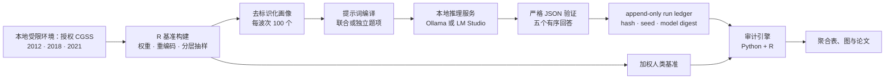

<div align="center">

# SurveyLLM-Eval

### 仅凭人口学特征，LLM 能否复现真实问卷人群？

**对 Qwen3.5-9B 与 31,856 名 CGSS 受访者的可复现审计**

[](https://www.python.org/)
[](https://www.r-project.org/)
[](README.md#system-architecture)
[](README.md#data-and-reproducibility-boundary)
[](LICENSE)

[English](README.md) · [中文](README.zh-CN.md)

[20 秒结论](#20-秒结论) · [我做了什么](#我做了什么) · [系统架构](#系统架构) ·
[核心结果](#核心结果) · [公开演示](#公开演示) · [数据边界](#数据与复现边界)

</div>

## 项目概览

这个项目检验的不是 LLM 能否生成“像人说的话”，而是它能否在总体层面复现真实受访者群体。我向本地运行的 Qwen3.5-9B 提供 300 个去标识化人口学画像，分别来自 CGSS 2012、2018 和 2021 的分层样本；模型从未看到这些人的真实态度。每个画像在五个性别态度题项上接受五次独立生成。

生成的人群与 31,856 名真实受访者的加权基准进行比较，同时纳入同规模重复人类抽样、问卷训练的机器学习模型与 joint-donor 基线。审计不止比较均值，还比较类别分布、画像间稳定差异、态度关系结构和重复生成的随机性。

结论是混合但总体否定的：Qwen3.5-9B 在一个波次上复现了总体方差，但 12 个波次级核心诊断中仍有 11 个落在同等人类抽样的 95% 参考范围之外。

## 20 秒结论

Qwen3.5-9B 能生成流畅、会随画像变化的回答，却没有复现被调查的人群。在 CGSS 三个波次中，12 个核心诊断有 11 个超出对应的人类抽样参考范围；只有 2012 年的方差比落入范围内。

| 均值误差 ↓ | 分布误差 ↓ | 方差恢复 → 1 | 相关误差 ↓ |
|---:|---:|---:|---:|
| **0.569–0.707** | **0.214–0.268** | **0.668–0.975** | **0.143–0.192** |
| 人类上界：0.168 | 人类上界：0.104 | 人类范围：0.846–1.141 | 人类上界：0.141 |


相较于早期 Qwen3-8B 实验，Qwen3.5-9B 的方差恢复明显改善；但项目发现的剩余误差仍是结构性的：题项均值与类别份额失真，画像间的稳定社会差异较弱，联合提示还会使态度之间比 CGSS 中更一致。

## 我做了什么

| 层次 | 实现 | 说明 |
|---|---|---|
| 本地推理 | Ollama / LM Studio adapter、严格 JSON schema、保存采样请求 | 不把受限数据发送到外部 API |
| 运行可靠性 | append-only JSONL ledger、prompt/config/model hash、断点续跑 | 保留实验来源与运行轨迹 |
| 评估 | Python 包与 survey-weighted R 分析 | 检验边际、子群体、方差、相关、稳定性和预测表现 |
| 基准 | 人类抽样包络、joint-donor、监督学习基线 | 区分稀疏画像的限制与生成器本身的失败 |
| 公开发布 | 合成 fixture、CLI、tests、CI、清晰的数据边界 | 在不重发许可微观数据的前提下保持可复现 |


## 为什么这样审计

“合成受访者”听起来合理，不等于代表了正确的人群。模型可能碰巧匹配一项平均数，却压缩分歧、扭曲群体差异，或生成真实人群中并不存在的态度相关性。因此，本项目把 LLM 当作需要验证的对象，而不是受访者的替代品。

| 被检验的对象 | 主诊断 | 仅看均值会漏掉什么 |
|---|---|---|
| 边际保真度 | 类别分布、均值误差、total variation | 回答形状错误 |
| 离散程度 | 方差比 | 人群被人为同质化 |
| 异质性 | 子群体梯度、matched-profile error | 社会差异被压平或夸大 |
| 关系结构 | correlation RMSE、joint-donor 基线 | 被虚构的态度一致性 |
| 随机行为 | 重复抽样、同画像稳定性 | 把随机性误认为保真度 |

> **核心原则：稳定不等于有效。** 模型可以稳定地错；多次采样不能修复错误的回答结构。

## 系统架构

受许可保护的微观数据始终留在本地环境。只有去标识化画像进入本地模型服务；公开仓库不包含受访者级 CGSS 数据或可回连画像的模型日志。



冻结实验使用 `qwen/qwen3.5-9b`、`neutral_verbal` 主提示、300 个画像和每个画像五次新的随机联合调用；全部 1,500 次主调用成功。LM Studio 未确认请求的 seed 是否实际生效，因此重复结果被视为新的随机调用，而非严格可复现的固定 seed 抽样。

完整模块设计见 [`docs/architecture.md`](docs/architecture.md)。

## 核心结果

| 诊断 | Qwen 三个波次的估计 | 人类 95% 参考范围 | 解读 |
|---|---:|---:|---|
| 绝对均值误差 ↓ | 0.569–0.707 | 上界 0.160–0.168 | 边际均值误差大 |
| Total variation ↓ | 0.214–0.268 | 上界 0.100–0.104 | 类别分布错误 |
| 方差比 → 1 | 0.668–0.975 | 0.846–1.141 | 有改进但跨波次不稳定 |
| Correlation RMSE ↓ | 0.143–0.192 | 上界 0.137–0.141 | 联合结构错误 |
| A425 平均绝对相关 ↓ | 0.232–0.335 | 上界 0.198–0.234 | 跨题项一致性过强 |


最重要的三点是：偏误不是单向意识形态移动，而是题项特异的；重复调用恢复的是随机性多于画像间稳定差异；稀疏画像也不是唯一原因，监督学习和 joint-donor 基线都能显著降低相应误差。

## 第二版：选项概率审计（2026 年 10 月）

第一版通过本地推理服务器为每个画像抽样五次回答，留下了三个问题：固定随机种子是否生效；模型对每个选项实际给出多大概率；联合提问时多出来的一致性，来自看到其他题目、看到自己之前的回答，还是来自 JSON 输出格式。第二版针对这三个问题重新设计。

- **做法**：同一个 Qwen3.5-9B（4-bit，MLX，本地运行），每个“画像 × 题目 × 实验条件”做一次前向计算，读取选项 1–5 的概率，共 12,000 次。完整计算两次运行逐位一致。
- **设计**：预注册的 2×2×2 析因实验，三个因素是题组是否可见（A）、是否有作答历史（B）、是否用 JSON 输出（C）。预注册文件 [`PREREGISTRATION_V2.md`](PREREGISTRATION_V2.md) 在给 CGSS 画像打分之前提交（`995b353`）。
- **影响结果的工程细节**：默认的 bf16 logits 会让选项概率随计算方式变化，最大差 0.031，因此末位投影改用 fp32；前缀缓存会改变 2/80 个测试提示的最高选项，正式运行一律完整计算。
- **主要结果**：A425 与其余四题的平均绝对相关，主要由作答历史推高（B 效应 +0.379，95% CI [0.339, 0.410]）；作答历史取最可能回答时，输出格式没有可检测的主效应，作用取决于题组是否可见。8 个条件的 log score 都差于对五个选项的均匀猜测，说明模型对个体是“有把握地错”。
- **第一版的思考模式**：核对第一版的运行脚本、回答文件和 LM Studio 日志后发现，第一版有系统提示词；整数 JSON schema 覆盖了提示词里对文字标签的要求，1,500 个回答都是整数；思考模式默认开启，回答实际写在未关闭的 `<think>` 块里。模型权重与第二版相同。用第一版提示词对 A421 做诊断，第一版回答的平均对数似然在思考块开启时为 −1.53，关闭时为 −8.30。两个探索性条件把比较扩展到五道题：思考块关闭时，A425 的平均绝对相关为 0.91，与第二版 A1-B1-C1 的 0.92 相当（差 −0.01，95% CI [−0.03, 0.01]）；思考块开启时为 0.44，比关闭时低 0.47（95% CI [0.41, 0.54]），与监督学习基线（HGB）的 0.45 接近。两版提示词的其他差别主要影响题目均值。上面的析因结果都在思考块关闭时得到，思考模式没有与 A、B、C 交叉。
- **测量模型**：有序单因子模型（WLSMV）中，A425 的标准化载荷在 CGSS 中为 0.16，在第一版五组抽样回答中为 0.39–0.55，与 CGSS 之差的 95% 区间都在 0 以上。第二版最可能回答构成的样本接近确定，因子解不合理（improper）。
- **抽样历史稳健性检验（预注册，2026-10-29 完成）**：析因实验中有历史的条件用的是最可能的前题回答。稳健性检验改为从模型自己的选项分布中按固定种子抽取，每个画像 5 条路径，共 30,000 次打分；重放种子可以复现每一条记录的历史。
  - 作答历史仍是最大来源：B 效应从 +0.379 降到 +0.309（95% CI [0.271, 0.338]）。取最可能回答会让 3 个有历史的条件的一致性高出 0.06–0.12，A0-B1-C1 差 −0.03（区间 −0.05 到 0.00）。
  - 回答层面（用抽出的回答计算相关）：4 个无历史条件为 0.09–0.21，落在真人每期 100 人抽样的范围内（中位数 0.10，97.5 分位数 0.22）；CGSS 全样本为 0.069。4 个有历史的条件为 0.36–0.57，高于这个范围，也高于第一版的 0.27（第一版是在思考块开启时生成的）。HGB 为 0.08。
  - 输出格式的结论不稳健：用抽样历史时，JSON 输出有一个小的正向主效应（+0.04，区间 0.02 到 0.07）；三因素交互在回答层面改变了符号。
  - 相关接近 0 时，回答层面相关的百分位区间会整体偏高（A1-B0-C0 点估计 0.090，区间 0.099 到 0.141），原因是重抽样中重复出现的画像会抬高绝对相关。因此回答层面的效应只报告点估计，计算出的区间保留在 `robustness_effects.csv` 中。
- **探索性分析（2026-10-29 补充，运行前已写入预注册）**：
  - 偏差方向取决于配置。按平等方向计分，第一版在 A421–A424 上比 CGSS 更平等、在 A425 上更不平等；同样的方向出现在思考模式开启时，也出现在只显示当前题并用 JSON 输出时。显示整个题组的 4 个条件，在 A421–A424 上都比 CGSS 更不平等；A425 在 8 个条件中有 6 个被低估。
  - 子群体差异。CGSS 中城乡和教育主要影响公共角色四题，对家务题几乎没有影响；女性与男性的差异在家务题上更大。模型把这些差异扩展到家务题：8 个条件中有 7 个，城乡对 A425 的系数在 0.21–0.88 之间（CGSS 为 0.02）；教育系数“公共角色减家务”的差在 CGSS 中为 +0.036，在每个条件中都更小，区间都在 0 以下。
  - 监督学习基线在回答层面的一致性为 0.08，和真人每期 100 人抽样的中位数（0.10）相当。画像之间差异很小的生成器，回答层面的相关自然接近 0，所以没有作答历史的条件落在真人范围内，并不说明结构是对的。
<!-- HUMANHIST_ZH -->
- **边界**：第二版不是对第一版的复现或验证。除思考模式外，两版在系统提示词、用户提示词、解码设置和作答历史的取法上仍有差别。探索性分析是在预注册结果已知之后设定的。结果只针对一个 4-bit 本地模型。

详见英文 README 的 [v2 部分](README.md#v2-option-probability-audit-october-2026)。

## 公开演示

公开 demo 不需要 CGSS 数据、模型下载或 API key。它使用明确标为合成的 fixture 与确定性的 mock adapter，覆盖 package、schema、边际和关系指标、报告生成与 CLI。

```bash
python -m pip install -e ".[dev]"
survey-llm-eval demo
pytest -q
```

如需在获授权的本地环境运行完整实验，请按英文 README 的 [Full pilot](README.md#run-the-authorized-pilot) 说明准备 CGSS 数据、模型服务和配置。该路径不会也不应在公开环境中运行。

## 数据与复现边界

- CGSS 微观数据受许可限制，仓库不分发原始记录、去标识化画像或画像级输出；
- 公开 demo 的数据与结果均为合成，仅用于验证软件流程；
- README 中报告的 CGSS 聚合结果和图表来自获授权的本地实验；
- 可复现并不意味着可公开原始数据。完整说明见 [`docs/reproducibility-boundary.md`](docs/reproducibility-boundary.md)。

## 研究材料、引用与许可

随仓库提供的论文、演示和引用信息见英文版的 [Research artifacts](README.md#research-artifacts) 与 [Citation](README.md#citation)。代码采用 MIT License；数据及相关衍生材料仍受原始许可条款约束。
