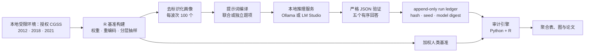
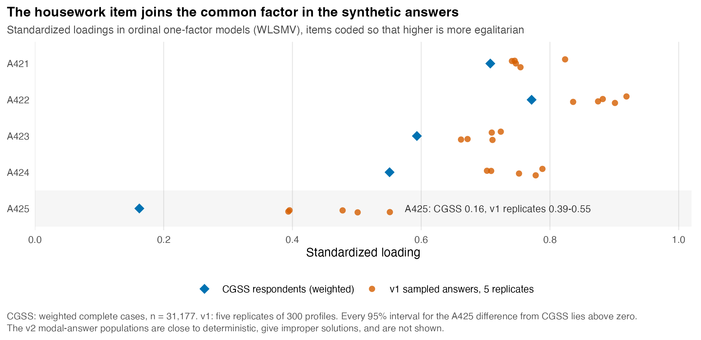
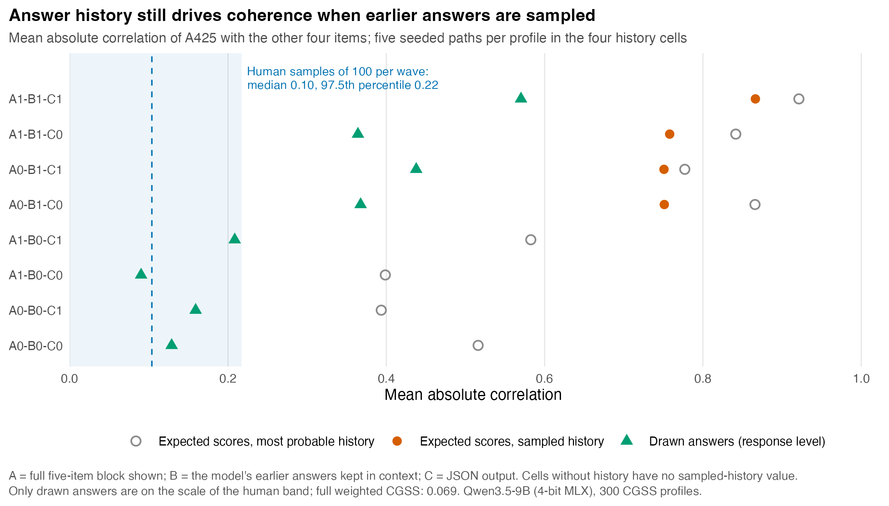
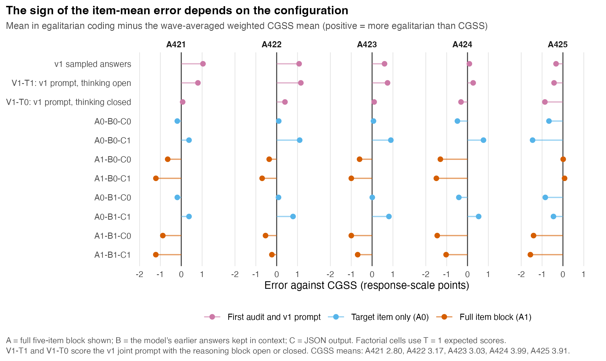
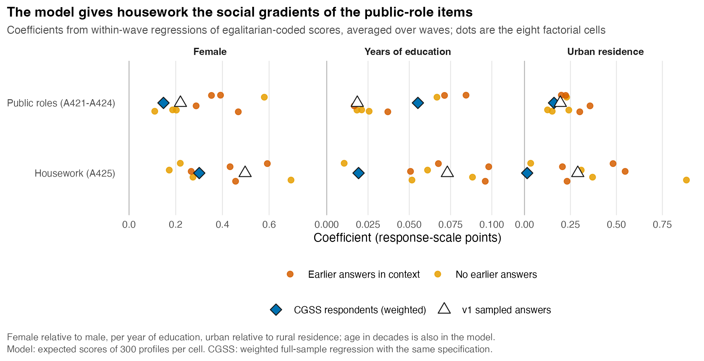
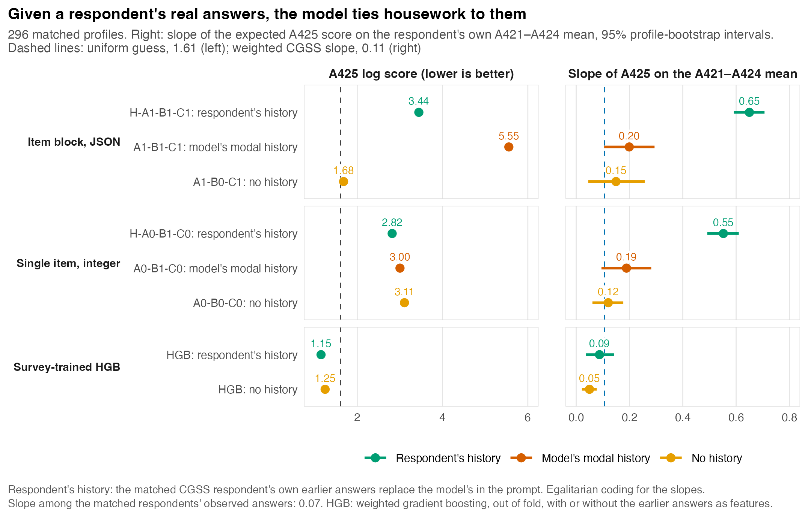
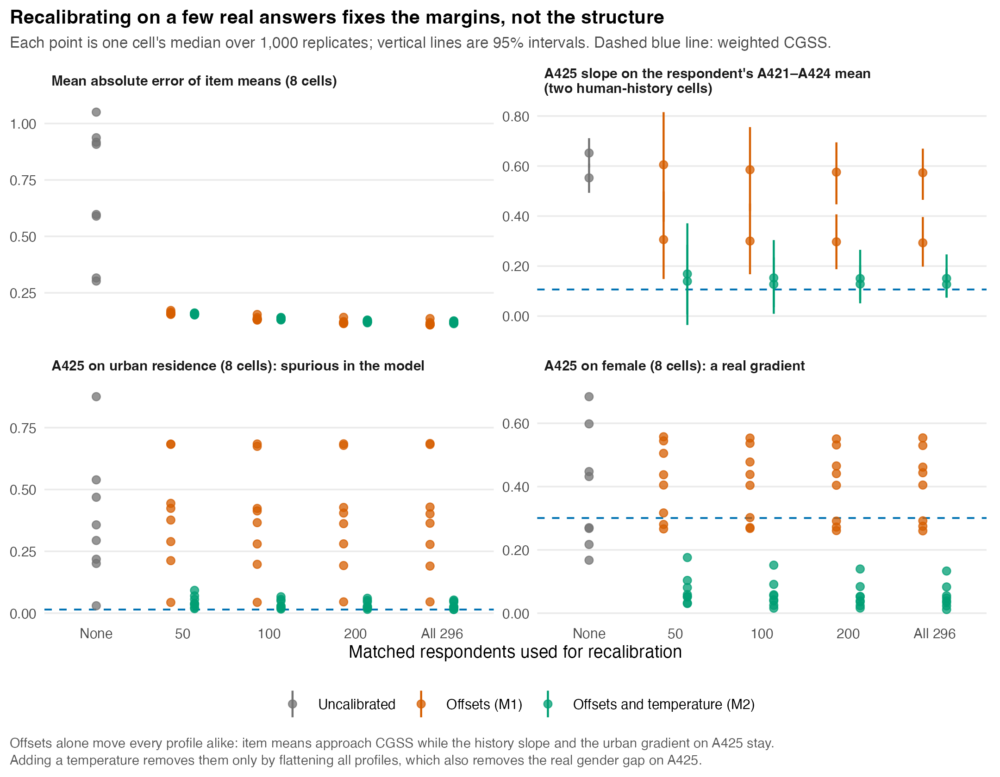

<div align="center">

# SurveyLLM-Eval

### 仅凭人口学特征，LLM 能否复现真实问卷人群？

**对 Qwen3.5-9B 与 31,856 名 CGSS 受访者的可复现审计**

[](https://github.com/4b8wsfdk7y-cloud/cgss-gender-attitude-llm-audit/actions/workflows/ci.yml)
[](https://www.python.org/)
[](https://www.r-project.org/)
[](README.md#system-architecture)
[](README.md#data-and-reproducibility-boundary)
[](LICENSE)

[English](README.md) · [中文](README.zh-CN.md)

[20 秒结论](#20-秒结论) · [我做了什么](#我做了什么) · [系统架构](#系统架构) ·
[核心结果](#核心结果) · [第二版](#第二版选项概率审计2026-年-10-月) · [公开演示](#公开演示) ·
[数据边界](#数据与复现边界)

</div>

## 项目概览

这个项目检验 LLM 生成的“合成受访者”能否在总体层面复现真实的受访者群体。回答听起来像人说的，并不等于复现了人群。我向本地运行的 Qwen3.5-9B 提供 300 个去标识化人口学画像，分别来自 CGSS 2012、2018 和 2021 的分层样本；模型从未看到这些人的真实态度。每个画像在五个性别态度题项上接受五次独立生成。

生成的人群与 31,856 名真实受访者的加权基准进行比较，同时纳入同规模重复人类抽样、问卷训练的机器学习模型与 joint-donor 基线。审计不止比较均值，还比较类别分布、画像间稳定差异、态度关系结构和重复生成的随机性。

结论是混合但总体否定的：Qwen3.5-9B 在一个波次上复现了总体方差，但 12 个波次级核心诊断中仍有 11 个落在同等人类抽样的 95% 参考范围之外。

> **2026 年 10 月更新。** 第二版直接读取模型对五个选项的概率，用预注册的 2×2×2 析因实验拆开第一版混在一起的三个呈现因素。核查中还发现，第一版的回答是在模型思考模式开启时生成的；用第一版提示词关掉思考后，A421 均值移动约 1 分，家务题与其余四题的一致性大约翻倍。思考关闭时，一致性主要来自模型自己之前的回答（预注册指标 +0.38，前题回答改为抽样时 +0.31）；题目均值偏差的方向随配置改变。详见[第二版](#第二版选项概率审计2026-年-10-月)。

## 20 秒结论

Qwen3.5-9B 能生成流畅、会随画像变化的回答，却没有复现被调查的人群。在 CGSS 三个波次中，12 个核心诊断有 11 个超出对应的人类抽样参考范围；只有 2012 年的方差比落入范围内。

| 均值误差 ↓ | 分布误差 ↓ | 方差恢复 → 1 | 相关误差 ↓ |
|---:|---:|---:|---:|
| **0.569–0.707** | **0.214–0.268** | **0.668–0.975** | **0.143–0.192** |
| 人类上界：0.168 | 人类上界：0.104 | 人类范围：0.846–1.141 | 人类上界：0.141 |


相较于早期 Qwen3-8B 实验，Qwen3.5-9B 的方差恢复明显改善；但项目发现的剩余误差仍是结构性的：题项均值与类别份额失真，画像间的稳定社会差异较弱，联合提示还会使态度之间比 CGSS 中更一致。

## 我做了什么

| 层次 | 实现 | 说明 |
|---|---|---|
| 本地推理 | Ollama / LM Studio adapter、严格 JSON schema、保存采样请求 | 不把受限数据发送到外部 API |
| 运行可靠性 | append-only JSONL ledger、prompt/config/model hash、断点续跑 | 保留实验来源与运行轨迹 |
| 评估 | Python 包与 survey-weighted R 分析 | 检验边际、子群体、方差、相关、稳定性和预测表现 |
| 基准 | 人类抽样包络、joint-donor、监督学习基线 | 区分稀疏画像的限制与生成器本身的失败 |
| 公开发布 | 合成 fixture、CLI、tests、CI、清晰的数据边界 | 在不重发许可微观数据的前提下保持可复现 |


## 为什么这样审计

“合成受访者”听起来合理，不等于代表了正确的人群。模型可能碰巧匹配一项平均数，却压缩分歧、扭曲群体差异，或生成真实人群中并不存在的态度相关性。因此，本项目把 LLM 当作需要验证的对象，而不是受访者的替代品。

| 被检验的对象 | 主诊断 | 仅看均值会漏掉什么 |
|---|---|---|
| 边际保真度 | 类别分布、均值误差、total variation | 回答形状错误 |
| 离散程度 | 方差比 | 人群被人为同质化 |
| 异质性 | 子群体梯度、matched-profile error | 社会差异被压平或夸大 |
| 关系结构 | correlation RMSE、joint-donor 基线 | 被虚构的态度一致性 |
| 随机行为 | 重复抽样、同画像稳定性 | 把随机性误认为保真度 |

> **核心原则：稳定不等于有效。** 模型可以稳定地错；多次采样不能修复错误的回答结构。

## 系统架构

受许可保护的微观数据始终留在本地环境。只有去标识化画像进入本地模型服务；公开仓库不包含受访者级 CGSS 数据或可回连画像的模型日志。



冻结实验使用 `qwen/qwen3.5-9b`、`neutral_verbal` 主提示、300 个画像和每个画像五次新的随机联合调用；全部 1,500 次主调用成功。LM Studio 未确认请求的 seed 是否实际生效，因此重复结果被视为新的随机调用，而非严格可复现的固定 seed 抽样。

完整模块设计见 [`docs/architecture.md`](docs/architecture.md)。

## 核心结果

| 诊断 | Qwen 三个波次的估计 | 人类 95% 参考范围 | 解读 |
|---|---:|---:|---|
| 绝对均值误差 ↓ | 0.569–0.707 | 上界 0.160–0.168 | 边际均值误差大 |
| Total variation ↓ | 0.214–0.268 | 上界 0.100–0.104 | 类别分布错误 |
| 方差比 → 1 | 0.668–0.975 | 0.846–1.141 | 有改进但跨波次不稳定 |
| Correlation RMSE ↓ | 0.143–0.192 | 上界 0.137–0.141 | 联合结构错误 |
| A425 平均绝对相关 ↓ | 0.232–0.335 | 上界 0.198–0.234 | 跨题项一致性过强 |


最重要的三点是（第一版配置下；第二版发现偏差方向随配置改变）：偏误因题项而异，没有整体朝一个意识形态方向移动；重复调用恢复的主要是随机性，画像间的稳定差异较少；稀疏画像也不是唯一原因，监督学习和 joint-donor 基线都能显著降低相应误差。

## 第二版：选项概率审计（2026 年 10 月）

第一版通过本地推理服务器为每个画像抽样五次回答，留下了三个问题：固定随机种子是否生效；模型对每个选项实际给出多大概率；联合提问时多出来的一致性，来自看到其他题目、看到自己之前的回答，还是来自 JSON 输出格式。第二版针对这三个问题重新设计。

| | 第一版（已冻结，2026 年 8 月） | 第二版（2026 年 10 月） |
|---|---|---|
| 模型 | Qwen3.5-9B，通过 LM Studio 调用 | Qwen3.5-9B，4-bit MLX，本地运行 |
| 回答 | 每个画像、每道题抽样五次（T = 0.7，top-p = 0.9） | 一次前向计算，读取 T = 1 时选项 1–5 的概率并重新归一化 |
| 可复现性 | 无法确认种子是否生效 | 完整计算两次运行逐位一致 |
| 设计 | 联合提示，外加一次单题独立运行 | 预注册的 2×2×2 析因实验：题组可见（A）× 作答历史（B）× JSON 输出（C） |
| 规模 | 300 个画像 | 300 个画像 × 5 道题 × 8 个条件 = 12,000 次前向计算 |

**影响结果的工程细节**

- 模型默认的 bf16 logits 精度较粗（步长 0.125），选项概率会随计算方式变化，最大差 0.031。末位投影改用 fp32 后，两种计算路径最多相差约 1e-5。最早的 1,072 条 bf16 记录已另存，正式运行从头开始，预注册的修改记录写明了这一点。
- 前缀（KV）缓存让 80 个测试提示中有 2 个的最高选项发生变化，所以正式提示一律完整计算。
- JSON 回答前缀末尾少一个空格时，模型会把最多 65% 的下一个 token 概率放在空格上。这个问题在正式运行前已修正。
- 每个条件中，有效选项“1”–“5”上的概率之和平均都在 0.999 以上。

**预注册。** [`PREREGISTRATION_V2.md`](PREREGISTRATION_V2.md) 于 2026 年 10 月 13 日提交（`995b353`），早于给任何 CGSS 画像打分。主要估计量是 A425 与其余四题的平均绝对相关，用画像层面的期望分数计算，在波次内做 2,000 次画像 bootstrap。

**主要结果**（[`output/v2/`](output/v2/)）

| 对 A425 平均绝对相关的效应 | 估计值 | 95% CI |
|---|---:|---:|
| B：保留作答历史 | +0.379 | [0.339, 0.410] |
| A：显示整个题组 | +0.048 | [0.022, 0.074] |
| C：JSON 输出 | +0.013 | [−0.013, 0.039] |
| A × C | +0.237 | [0.192, 0.286] |
| A × B × C | −0.138 | [−0.239, −0.044] |


- 一致性偏高主要来自模型看到自己之前的回答。无作答历史的条件为 0.39–0.58（探索性的监督学习基线 HGB 为 0.45），有作答历史的条件为 0.78–0.92。CGSS 回答层面的值（0.07）用个人回答计算，与期望分数的相关不能直接比较。
- 作答历史取最可能回答时，输出格式没有可检测的主效应，它的作用取决于题组是否可见。用抽样历史时，主效应小而为正（见下文稳健性检验）。
- 每个条件的匹配 log score（1.97–3.06）都比对五个选项的均匀猜测（ln 5 ≈ 1.61）差，说明模型对个体受访者是“有把握地错”。最好的 RPS 是 0.191（A0-B0-C0），HGB 为 0.149。


- 边际准确度取决于呈现方式。题目均值的平均绝对误差从 0.30（A0-B0-C0）到 1.06（A1-B1-C0）。最接近 CGSS 均值的条件，画像间方差比只有 0.09，几乎给每个人相同的回答。

**第一版和第二版为什么不同：思考模式**

第二版的题目均值与第一版相差很大（A421 按原始 1–5 计分，A1-B1-C1 为 4.42，第一版为 2.16），文字标签条件也解释不了这个差距。核对第一版的运行脚本、回答文件和运行时的 LM Studio 服务器日志后，发现第一版的说明有三处写错或遗漏：

- 第一版用了系统提示词（“你正在参加一项社会调查模拟。严格遵守用户要求，只返回JSON，不解释推理。”）。
- 第一版从未输出文字标签。每个请求都带有只允许整数的 JSON schema，覆盖了提示词里对标签的要求；1,500 个回答都是整数 JSON。
- 第一版开着思考模式。LM Studio 对这个模型默认打开思考，Qwen3.5 的对话模板没有 `/no_think` 开关。日志里每次调用的 `content` 都是空的，JSON 在 `reasoning_content` 中，说明模型是在未关闭的 `<think>` 块里写出回答的。模型权重与第二版相同。

一项诊断只改变思考块的开关，为 300 个第一版提示的 A421 打分：

| A421，第一版提示词 | 思考开启（第一版） | 思考关闭（第二版） |
|---|---:|---:|
| 按第一版解码设置（T = 0.7，top-p = 0.9）的期望分数 | 2.13 | 3.26 |
| 第一版抽样均值 | 2.16 | 2.16 |
| 1,500 个第一版回答的平均对数似然 | −1.53 | −8.30 |
| 概率为 0 的第一版回答数 | 15 | 395 |
| 与第一版画像均值的相关 | 0.54 | 0.27 |

思考块开启时，对第一版回答的解释要好得多。两个探索性条件在运行前已写入预注册，把比较扩展到全部五道题：

| 第一版提示词，五道题，前题取最可能回答 | V1-T1：思考开启 | V1-T0：思考关闭 | A1-B1-C1（第二版提示词） |
|---|---:|---:|---:|
| A425 平均绝对相关 [95% CI] | 0.44 [0.37, 0.50] | 0.91 [0.90, 0.92] | 0.92 [0.90, 0.93] |
| 与第一版抽样题目均值的平均绝对差（第一版解码设置） | 0.23 | 0.62 | 1.47 |
| 题目均值相对 CGSS 的平均绝对误差（T = 1） | 0.68 | 0.36 | 0.95 |
| 画像间方差比 | 0.14 | 0.65 | 0.41 |
| 匹配 log score（均匀猜测为 1.61） | 1.96 | 1.99 | 3.06 |

- 用第一版提示词并关闭思考时，一致性与 A1-B1-C1 相同（差 −0.01，95% CI −0.03 到 0.01）。打开思考块使一致性下降 0.47（95% CI 0.41 到 0.54）。就主要估计量而言，第一版和第二版设置之间的差别由思考模式解释，系统提示词和措辞不起作用。
- 提示词的差别会移动题目均值。关闭思考时，第一版提示词比 A1-B1-C1 更接近 CGSS（平均绝对误差 0.36 对 0.95）。
- 思考开启时最接近第一版的题目均值。A421 和 A425 与第一版相差不超过 0.11；A422–A424 比第一版低 0.25–0.45。这两个条件以最可能的前题回答为条件，第一版的前题回答则是抽样得到的，两种程序并不相同。
- 上面的析因结果都在思考关闭时得到。思考模式没有与 A、B、C 交叉，所以思考开启时作答历史效应有多大还不知道。V1-T1 保留了作答历史，一致性为 0.44，接近 HGB 基线的 0.45。这些值来自期望分数，与第一版用抽样回答算出的 0.23–0.34 不在同一尺度上。
- 这两个条件是在 A421 诊断之后加入的，属于探索性分析（[`output/v2/v1_context_*.csv`](output/v2/)、[`scripts/11_run_v1_context_cells.py`](scripts/11_run_v1_context_cells.py)、[`scripts/13_analyze_v1_context.py`](scripts/13_analyze_v1_context.py)）。

**测量模型（预注册第 3 部分）**

五道题的有序单因子模型（WLSMV），重新编码为分数越高越平等（[`output/v2/part3_*.csv`](output/v2/)）：

| 样本 | n | A425 标准化载荷 | 其他题载荷 | 解 |
|---|---:|---:|---:|---|
| CGSS（加权，完整个案） | 31,177 | 0.16 | 0.55–0.77 | 合理 |
| 第一版抽样回答（5 组） | 每组 300 | 0.39–0.55（中位数 0.48） | 0.66–0.92 | 合理 |
| 第二版最可能回答，A1-B1-C1 | 300 | 1.02 | 0.88–0.99 | 不合理（improper） |
| 第二版最可能回答，A0-B0-C0 | 300 | 0.57 | −0.28–1.09 | 不合理；删去 A424 |



- 在每个合成样本中，A425 在共同因子上的载荷都远高于真人：第一版各组与 CGSS 之差为 0.23–0.39，95% 区间都在 0 以上。最可能回答构成的样本接近确定（多分格相关最高 0.998），因子解不合理，CGSS 与 A1-B1-C1 的形态等值模型无法估计。
- CGSS 与第一版各组比较：阈值相等和载荷相等都被 scaled difference test 拒绝（p < .001），scaled CFI 的变化则小于 0.01。真人样本约为合成样本的一百倍，所以上面的载荷差异更有信息量。
- 等级反应模型的区分度给出同样的结果：A425 的区分度与其余四题平均区分度之比，CGSS 为 0.17，第一版各组为 0.30–0.53。

**预注册稳健性检验：抽样作答历史（2026 年 10 月 29 日）**

析因实验中有历史的条件，用的是最可能的前题回答。稳健性检验在运行前写入预注册 2026-10-28 条目，改为从模型自己的选项分布中按固定种子抽取，每个画像 5 条路径：300 个画像 × 4 个有历史的条件 × 5 条路径 × 5 道题 = 30,000 次打分。重放种子可以复现每一条记录的历史（[`output/v2/robustness_*.csv`](output/v2/)）。

| 条件 | 最可能历史，期望分数 | 抽样历史，期望分数（R2） | 抽出的回答，回答层面（R1） |
|---|---:|---:|---:|
| A0-B0-C0 | 0.52 | 无历史 | 0.13 |
| A0-B0-C1 | 0.39 | 无历史 | 0.16 |
| A1-B0-C0 | 0.40 | 无历史 | 0.09 |
| A1-B0-C1 | 0.58 | 无历史 | 0.21 |
| A0-B1-C0 | 0.87 | 0.75 | 0.37 |
| A0-B1-C1 | 0.78 | 0.75 | 0.44 |
| A1-B1-C0 | 0.84 | 0.76 | 0.36 |
| A1-B1-C1 | 0.92 | 0.87 | 0.57 |

| 效应 | 最可能历史 | 抽样历史（R2） | 回答层面（R1） |
|---|---:|---:|---:|
| B：作答历史 | +0.379 [0.339, 0.410] | +0.309 [0.271, 0.338] | +0.288 |
| A：题组可见 | +0.048 [0.022, 0.074] | +0.048 [0.021, 0.074] | +0.035 |
| C：JSON 输出 | +0.013 [−0.013, 0.039] | +0.042 [0.015, 0.070] | +0.106 |
| A × C | +0.237 [0.192, 0.286] | +0.207 [0.163, 0.256] | +0.112 |
| A × B × C | −0.138 [−0.239, −0.044] | −0.197 [−0.290, −0.107] | +0.048 |



- 作答历史仍是最大效应。取最可能回答会让 3 个有历史的条件的一致性高出 0.06–0.12（A0-B1-C1 为 −0.03，区间 −0.05 到 0.00），作答历史效应从 0.38 降到 0.31。
- 回答层面：4 个无历史条件为 0.09–0.21，落在真人每期 100 人抽样的范围内（中位数 0.10，97.5 分位数 0.22），CGSS 加权全样本为 0.069。4 个有历史的条件为 0.36–0.57，高于这个范围，也高于第一版的 0.27（第一版回答在思考块开启时生成）。问卷训练的 HGB 对照为 0.08。
- 输出格式的结论不稳健：用抽样历史时，JSON 输出有一个小的正向主效应（+0.04，区间 0.02 到 0.07）。三因素交互在回答层面改变了符号。
- 用抽样历史时，题目均值相对 CGSS 的误差变化不大（有历史的条件平均绝对误差为 0.35–0.97，原来为 0.31–1.06），画像间方差比在 4 个条件中有 3 个下降。
- 相关较小时，回答层面相关的百分位区间会整体高于点估计（A1-B0-C0 点估计 0.090，区间 0.099 到 0.141），原因是重抽样中重复出现的画像会抬高接近 0 的绝对相关。因此这里的回答层面效应只报告点估计，计算出的区间保留在 `robustness_effects.csv` 中。

**探索性分析（2026 年 10 月 29 日补充）**

在运行前写入预注册 2026-10-29 条目，不改变任何预注册估计量。

*题目均值误差的方向取决于配置。* 按平等方向计分（[`output/v2/v2_item_means_egalitarian.csv`](output/v2/v2_item_means_egalitarian.csv)），相对三期平均的 CGSS 均值的误差：

| | A421 | A422 | A423 | A424 | A425 |
|---|---:|---:|---:|---:|---:|
| CGSS 均值 | 2.80 | 3.17 | 3.03 | 3.99 | 3.91 |
| 第一版抽样回答（思考开启） | +1.04 | +1.08 | +0.60 | +0.09 | −0.33 |
| V1-T1（第一版提示词，思考开启） | +0.80 | +1.16 | +0.74 | +0.27 | −0.43 |
| A0-B0-C1（只显示当前题，JSON） | +0.37 | +1.10 | +0.90 | +0.77 | −1.46 |
| A1-B1-C1（第二版参考条件） | −1.22 | −0.23 | −0.69 | −1.03 | −1.56 |
| A1-B0-C0（显示题组，无历史，整数） | −0.65 | −0.36 | −0.60 | −1.30 | +0.01 |



第一版的模式（A421–A424 比 CGSS 更平等，A425 更不平等）出现在思考块开启时，也出现在只显示当前题并用 JSON 输出时。显示整个题组的 4 个条件，在 A421–A424 上都比 CGSS 更不平等。A425 在 8 个析因条件中有 6 个被低估。偏差的方向取决于配置，不能只归于模型本身。

*子群体差异*（[`output/v2/exploratory_subgroup_gradients.csv`](output/v2/exploratory_subgroup_gradients.csv)）。在每个波次内，用性别、受教育年限、年龄和城乡对按平等方向计分的期望分数做回归（第一版的设定），基准是 CGSS 全样本加权回归。三期平均的系数：

| 系数 | CGSS，公共角色（A421–A424） | CGSS，家务（A425） | 模型，公共角色（8 个条件） | 模型，家务（8 个条件） | 第一版抽样，公共角色 / 家务 |
|---|---:|---:|---:|---:|---:|
| 女性 | 0.15 | 0.30 | 0.11–0.58 | 0.17–0.69 | 0.22 / 0.50 |
| 受教育年限 | 0.055 | 0.019 | 0.017–0.084 | 0.011–0.098 | 0.018 / 0.073 |
| 城镇居住 | 0.16 | 0.01 | 0.13–0.36 | 0.03–0.88 | 0.19 / 0.29 |



- CGSS 受访者中，城镇居住和受教育程度与公共角色题上更平等的回答相关，与 A425 几乎无关；女性与男性的差异在 A425 上比在公共角色题上更大。
- 模型把社会梯度扩展到家务题。8 个析因条件中有 7 个，城镇居住对 A425 的系数为 0.21–0.88，CGSS 为 0.01，差值的区间都在 0 以上；第一版抽样回答为 0.29。受教育年限“公共角色减家务”的差，CGSS 为 +0.036，各条件在 −0.070 到 +0.015 之间，差值的区间都在 0 以下。
- 公共角色题上的性别差距在 8 个条件中有 7 个大于 CGSS。家务题上是否保留更大的性别差距，因条件而异。
- 这是 A425 结果在子群体层面的对应：模型倾向于给整个题组同一组社会梯度。这里比较的系数很多，所以只描述在各条件中一致出现的模式。

*回答层面的问卷训练对照。* 从 HGB 的 out-of-fold 分布中为每个画像抽 5 次，回答层面的 A425 一致性为 0.08，真人每期 100 人抽样的中位数为 0.10。画像之间分布差异很小的生成器，无论结构如何，回答层面的相关都会很低，所以无历史的条件接近真人范围，并不能说明结构是对的。

*真人历史条件*（[`output/v2/exploratory_human_history_calibration.csv`](output/v2/exploratory_human_history_calibration.csv)、[`exploratory_history_dependence.csv`](output/v2/exploratory_history_dependence.csv)）。H-A1-B1-C1 和 H-A0-B1-C0 的提示词分别同 A1-B1-C1 和 A0-B1-C0，但每道题前面的历史换成匹配的 CGSS 受访者自己对前几题的回答（296 个五题都有回答的画像，每个条件 1,184 次前向计算）。这两个条件检验的是，模型拿到一个人的真实回答后，是否按真人回答之间的关系来使用这些信息。

| 来源 | log score，A422–A424 | log score，A425 | A425 对受访者 A421–A424 均值的斜率 |
|---|---:|---:|---:|
| H-A1-B1-C1（受访者历史） | 1.66 | 3.44 | 0.65 [0.59, 0.71] |
| A1-B1-C1（模型的最可能历史） | 2.34 | 5.55 | 0.20 |
| A1-B0-C1（无历史） | 1.94 | 1.68 | 0.15 |
| H-A0-B1-C0（受访者历史） | 1.49 | 2.82 | 0.55 [0.49, 0.61] |
| A0-B1-C0（模型的最可能历史） | 1.84 | 3.00 | 0.19 |
| A0-B0-C0（无历史） | 2.05 | 3.11 | 0.12 |
| HGB，带受访者历史 | 1.23 | 1.15 | 0.09 [0.04, 0.14] |
| HGB，无历史 | 1.41 | 1.25 | 0.05 |
| CGSS，加权（观测回答） | | | 0.11 |



- H-A1-B1-C1 中，与无历史条件相比，受访者自己的回答让模型对 A423、A424 的预测变好（log score −0.37、−0.45，区间都在 0 以下），却让 A425 明显变差（+1.76，区间 1.42 到 2.13）。
- H-A0-B1-C0 中，与无历史条件相比，四道题的 log score 都变好，A425 也是（−0.29，区间 −0.49 到 −0.10），但 A425 的 RPS 变差（+0.058，区间 0.041 到 0.075）。表中所有模型条件在 A425 上的 log score 都比均匀猜测（1.61）差。
- 带同样历史的 HGB 在每道题、两种评分上都变好，A425 也是（log score −0.095，RPS −0.008）。所以受访者的回答能否帮助模型预测 A425，取决于条件和评分方式。
- 两个条件中，看到受访者的真实回答后，模型的 A425 预测随这些回答均值变化的斜率分别为 0.65 和 0.55，是 CGSS（0.11）的五到六倍，比带历史的 HGB 分别高 0.56（区间 0.49 到 0.62）和 0.46（区间 0.39 到 0.53）。期望分数的斜率和观测回答的斜率估计的是同一个条件均值，所以可以直接比较。
- 所以过度一致不只是模型在自己之前的错误上继续延伸：无论看到的是自己的回答还是受访者的回答，模型都让家务题跟着前四题走。
- H-A0-B1-C0 在 H-A1-B1-C1 之后运行，按预注册 2026-10-29 的运行顺序条目，296 个画像全部跑完后才分析。

**另外两项探索性分析（2026 年 10 月 29 日晚补充）**

两项都在运行之前写进了预注册 10 月 29 日晚的条目。

*用少量真人样本重新校准*（[`output/v2/exploratory_calibration_summary.csv`](output/v2/exploratory_calibration_summary.csv)、[`exploratory_calibration_gradients.csv`](output/v2/exploratory_calibration_gradients.csv)、[`exploratory_calibration_history_slope.csv`](output/v2/exploratory_calibration_history_slope.csv)）。一种常见的提议是用少量真人的回答校正合成受访者。这里对每个条件的每道题，用 n 个匹配受访者（50、100、200 人或全部 296 人）的回答，以惩罚最大似然重新校准选项分布，分两种做法：只加类别偏移（M1），以及同时加类别偏移和逆温度（M2）。1,000 次重复中，每次在期内重抽画像，再重新抽取校准样本；表中数值是各次重复的中位数和 95% 区间。8 个析因条件给出各条件中位数的范围，括号里是与 CGSS 之差的区间不含 0 的条件数。

| | 不校准 | M1，n = 100 | M2，n = 100 | CGSS |
|---|---:|---:|---:|---:|
| 题目均值的平均绝对误差 | 0.30–1.05 | 0.13–0.15 | 0.13–0.14 | |
| 画像间方差比 | 0.04–0.41 | 0.09–0.37 | 0.01–0.04 | |
| A425 对受访者 A421–A424 均值的斜率，H-A1-B1-C1 | 0.65 [0.59, 0.71] | 0.59 [0.42, 0.76] | 0.15 [0.01, 0.30] | 0.11 |
| A425 对受访者 A421–A424 均值的斜率，H-A0-B1-C0 | 0.55 [0.49, 0.61] | 0.30 [0.17, 0.45] | 0.13 [0.04, 0.23] | 0.11 |
| A425 对城镇居住的系数 | 0.03–0.88（7/8） | 0.04–0.68（7/8） | 0.02–0.07（0/8） | 0.01 |
| A425 对女性的系数 | 0.17–0.68（6/8） | 0.27–0.55（5/8） | 0.02–0.15（7/8） | 0.30 |
| 公共角色指数对受教育年限的系数 | 0.018–0.085（8/8） | 0.021–0.074（3/8） | 0.009–0.024（8/8） | 0.055 |



- 只加偏移时，100 个真人回答就能让题目均值接近 CGSS。偏移让所有画像朝同一方向移动，所以结构上的误差留了下来：A425 的城乡梯度在 8 个条件中仍有 7 个偏离 CGSS，两个真人历史条件的斜率为 0.59 和 0.30，分别是 CGSS 的 5.5 倍和 2.8 倍。
- 加上逆温度后，虚假的结构消失了：斜率降到 0.15 和 0.13，与 CGSS 之差的区间包含 0，A425 的城乡梯度也回到 CGSS 的水平。这是靠压平画像之间的差别做到的。画像间方差比降到 0.01–0.04，真实存在的梯度也随之消失：A425 上的性别差距由 CGSS 的 0.30 降到 0.02–0.15，公共角色题的教育梯度由 0.055 降到 0.009–0.024。
- n = 100 时拟合出的逆温度为 0.01–0.53，A425 在每个条件中都低于 0.31，校准后的分布保留的画像层面信息很少。逆温度没有限定为正数，n = 296 时有一次拟合（A1-B0-C0 的 A424）略小于 0。
- 因此，少量真人回答能修好边际分布，修不好结构；能去掉虚假结构的校准，也同时去掉了真实的结构。这与预注册条目中写下的预期一致。校准样本来自被打分画像对应的受访者，对研究者来说是最有利的情形。
- 这里的不校准数值基于 296 个画像，并取 bootstrap 中位数，所以和前面各表可能在第二位小数上不同。

*问卷曝光探针*（[`output/v2/exploratory_exposure_order_test.csv`](output/v2/exploratory_exposure_order_test.csv)、[`exploratory_exposure_recall.csv`](output/v2/exploratory_exposure_recall.csv)）。此前没有检验过模型是否见过 A42 题组。探针把五道题按每行一题排成全部 120 种顺序，分别放在 CGSS 标题和中性标题下计算概率，看 CGSS 的顺序排在第几。正面对照对社会主义核心价值观的前五个词做同样的检验，模型应当知道它们的顺序。探针使用原始文本，不套对话模板，每种顺序做一次前向计算。

| 文本 | 标准顺序在 120 种顺序中的排名 | 置换 p 值 | 相对中位顺序的对数概率差 |
|---|---:|---:|---:|
| 正面对照（社会主义核心价值观） | 1 | 0.008 | +14.43 |
| A42 题组，CGSS 标题 | 85 | 0.71 | −2.33 |
| A42 题组，中性标题 | 23 | 0.19 | +4.18 |

- 探针能测出背过的顺序：正面对照排第一。CGSS 标题下，CGSS 顺序的概率低于中位顺序，在中性标题下反而排得更靠前。按预注册的判读标准，没有证据表明模型见过按 CGSS 顺序列出这组题的文本。
- 给出按 CGSS 顺序排列的前 k 道题后，两种标题下模型都没有写出五道题中的任何一道，写出的是其他关于性别角色的说法。其中一条生成内容具有冒犯性，在公开表格中打了码，保留了它的 SHA-256。
- 探针只检验问卷文本。CGSS 已发表的回答分布是否进入了训练数据，用这种方法无法检验。

**第二版不能说明的问题**

- 第二版不是对第一版的复现或验证。除思考模式外，两版在系统提示词、用户提示词、解码设置（第一版在 T = 0.7、top-p = 0.9 下抽样，第二版读取 T = 1 的概率）和作答历史上都有差别。
- 探索性分析是在预注册结果已知之后设定的，应按探索性结果理解。
- 结果只描述一个 4-bit 本地模型，不能推广到其他模型或量化方式。

**代码。** [`scripts/07_run_logprob_audit.py`](scripts/07_run_logprob_audit.py) 运行前向计算，写入只追加的记录文件（append-only ledger）；[`scripts/08_export_human_benchmark.R`](scripts/08_export_human_benchmark.R) 导出加权真人基准；[`scripts/09_analyze_logprob_audit.py`](scripts/09_analyze_logprob_audit.py) 计算估计量和 bootstrap 区间；[`scripts/10_plot_v2.R`](scripts/10_plot_v2.R) 用 `output/v2/` 中的聚合表画主要结果的两张图；[`scripts/11_run_v1_context_cells.py`](scripts/11_run_v1_context_cells.py) 和 [`scripts/13_analyze_v1_context.py`](scripts/13_analyze_v1_context.py) 运行并分析两个第一版提示词条件；[`scripts/12_measurement_models.R`](scripts/12_measurement_models.R) 估计第 3 部分的测量模型；[`scripts/14_analyze_sampled_history.py`](scripts/14_analyze_sampled_history.py) 分析抽样历史稳健性检验，[`scripts/20_plot_robustness.R`](scripts/20_plot_robustness.R) 画它的图；脚本 15–19 运行和分析探索性的真人历史条件、带历史的 HGB、子群体梯度和按平等方向计分的题目均值；[`scripts/21_plot_exploratory.R`](scripts/21_plot_exploratory.R) 画测量模型和探索性分析的图；[`scripts/22_calibrate_with_human_sample.py`](scripts/22_calibrate_with_human_sample.py) 运行重新校准分析，[`scripts/24_plot_calibration.R`](scripts/24_plot_calibration.R) 画它的图；[`scripts/23_probe_questionnaire_exposure.py`](scripts/23_probe_questionnaire_exposure.py) 运行问卷曝光探针，只需要本地模型。选项概率的提取和析因提示词在 [`src/survey_llm_eval/probabilities.py`](src/survey_llm_eval/probabilities.py) 和 [`src/survey_llm_eval/factorial.py`](src/survey_llm_eval/factorial.py) 中，测试在 `tests/test_probabilities.py` 和 `tests/test_factorial.py`。运行这些脚本需要获授权的 CGSS 衍生文件。

## 公开演示

公开 demo 不需要 CGSS 数据、模型下载或 API key。它使用明确标为合成的 fixture 与确定性的 mock adapter，覆盖 package、schema、边际和关系指标、报告生成与 CLI。

```bash
python -m pip install -e ".[dev]"
survey-llm-eval demo
pytest -q
```

如需在获授权的本地环境运行完整实验，请按英文 README 的 [Full pilot](README.md#run-the-authorized-pilot) 说明准备 CGSS 数据、模型服务和配置。该路径不会也不应在公开环境中运行。

## 数据与复现边界

- CGSS 微观数据受许可限制，仓库不分发原始记录、去标识化画像或画像级输出；
- 公开 demo 的数据与结果均为合成，仅用于验证软件流程；
- README 中报告的 CGSS 聚合结果和图表来自获授权的本地实验；
- 可复现并不意味着可公开原始数据。完整说明见 [`docs/reproducibility-boundary.md`](docs/reproducibility-boundary.md)。

## 研究材料、引用与许可

随仓库提供的论文、演示和引用信息见英文版的 [Research artifacts](README.md#research-artifacts) 与 [Citation](README.md#citation)。代码采用 MIT License；数据及相关衍生材料仍受原始许可条款约束。
